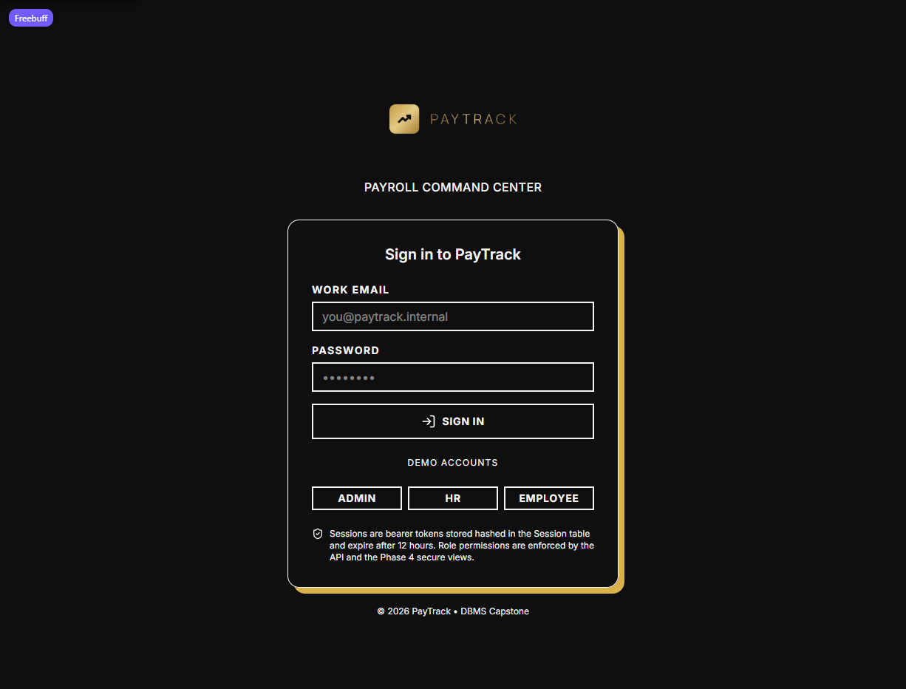
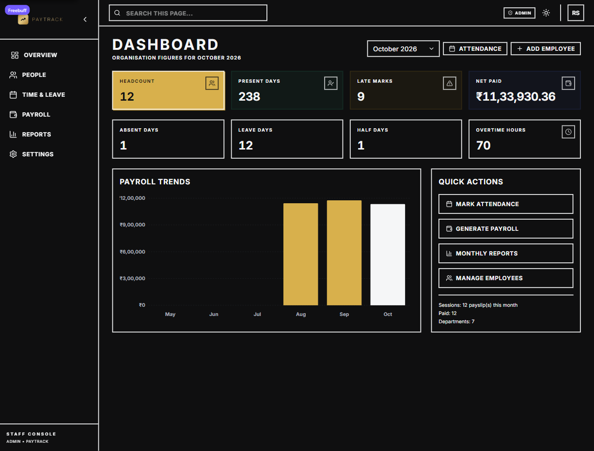
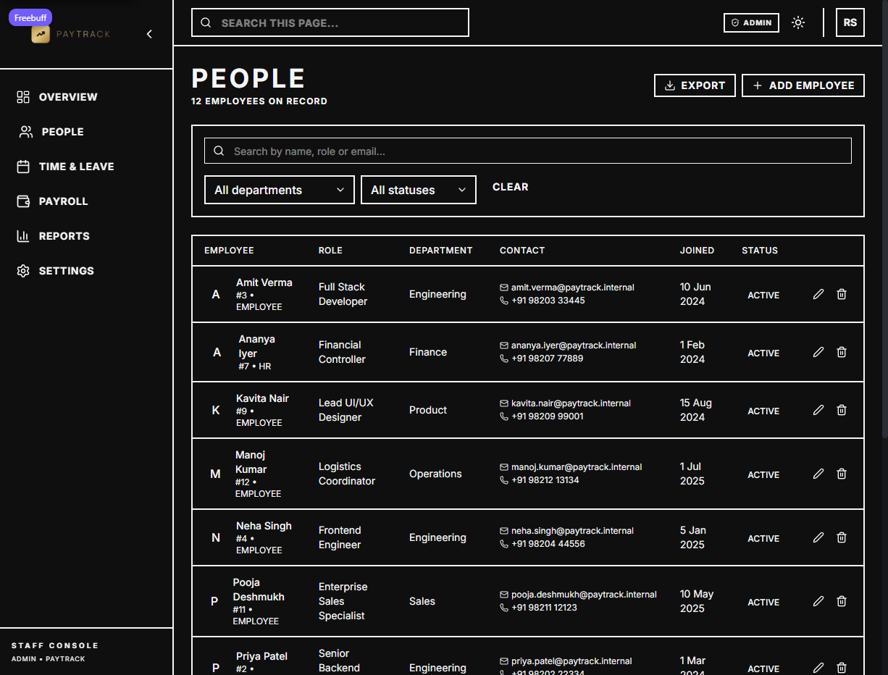
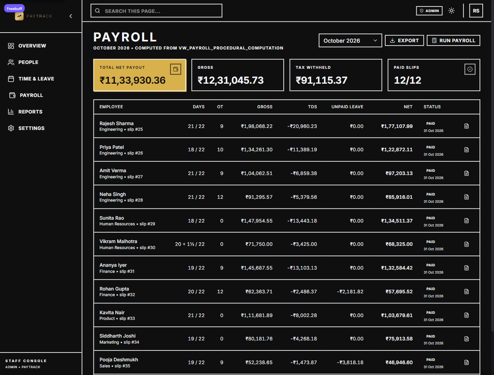
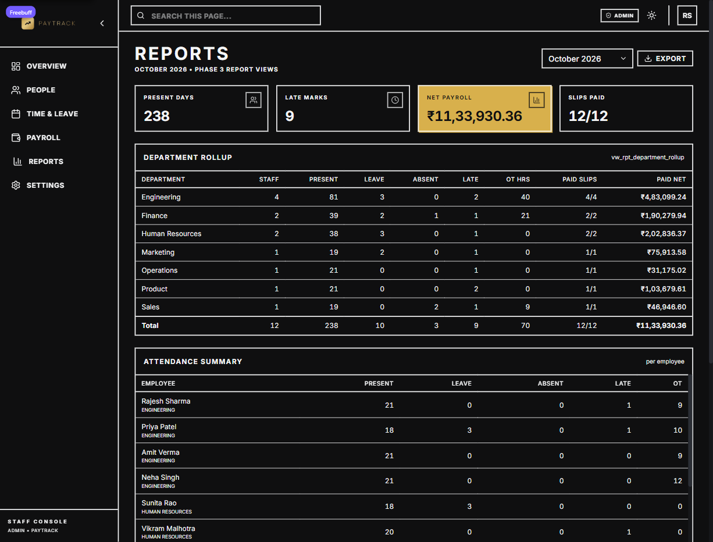
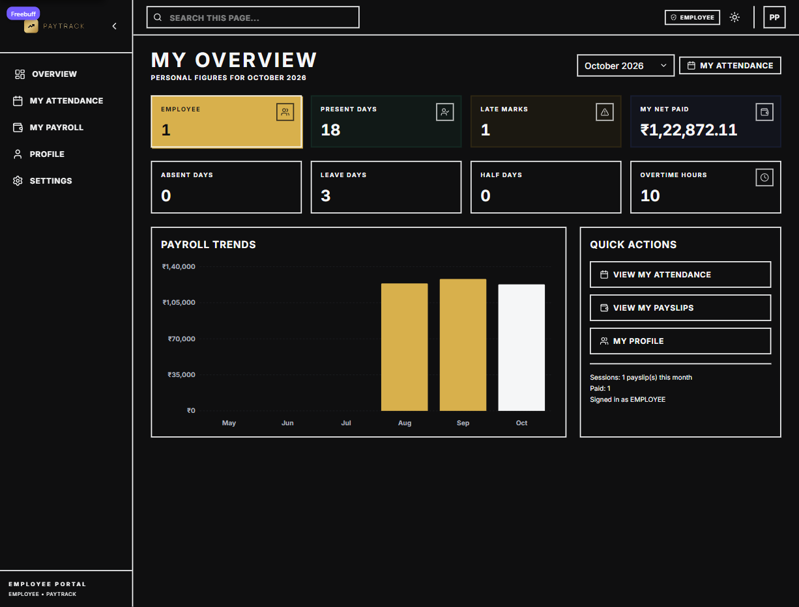

# PayTrack — Payroll & Attendance Management System

PayTrack is a role-based payroll and attendance platform built database-first: the business rules
(salary computation, tax tiers, attendance guards, authorisation) live in SQL, and a React client and
a thin Node HTTP API sit on top of them. Every figure the UI shows is computed by the database — the
browser never calculates pay.

| | |
|---|---|
| **Student Name** | Vinayak |
| **Roll Number** | 2501730150 |
| **Course** | Database Management Systems |
| **University** | K.R. Mangalam University |
| **Project** | PayTrack – Payroll & Attendance Management System |

---

## Academic phase structure

| Phase | Title | Deliverables | Evidence | Status |
|---|---|---|---|---|
| **1** | Data modelling & schema design | 3NF schema, keys, CHECK constraints, Phase 1 indexes | [`database/schema.sql`](database/schema.sql) · [`docs/phase-1/schema-design.md`](docs/phase-1/schema-design.md) | Complete |
| **2** | Procedural implementation | Salary/tax views, attendance + payroll triggers, 12-employee seed | [`database/procedures.sql`](database/procedures.sql) · [`database/triggers.sql`](database/triggers.sql) · [`docs/phase-2/procedural-implementation.md`](docs/phase-2/procedural-implementation.md) | Complete |
| **3** | Query & report development | Five report views, two report indexes, measured query plans | [`database/reports.sql`](database/reports.sql) · [`docs/phase-3/query-reports.md`](docs/phase-3/query-reports.md) | Complete |
| **4** | Security, RBAC & testing | Hashed credentials, RBAC tables, row-level secure views, 51 security tests | [`database/security.sql`](database/security.sql) · [`docs/phase-4/security-testing.md`](docs/phase-4/security-testing.md) | Complete |
| **5** | Full-stack integration & UI | REST API, React client, CLI, 325 passing assertions | [`server/`](server) · [`src/`](src) · [`docs/phase-5/api-reference.md`](docs/phase-5/api-reference.md) | Complete |

---

## Table of contents

1. [Academic phase structure](#academic-phase-structure)
2. [Screenshots](#screenshots)
3. [Features](#features)
4. [Architecture](#architecture)
5. [Database design](#database-design)
6. [Role matrix](#role-matrix)
7. [Getting started](#getting-started)
8. [Demo accounts](#demo-accounts)
9. [Testing](#testing)
10. [Project structure](#project-structure)
11. [Real-world scaling](#real-world-scaling)
12. [Limitations](#limitations)
13. [Documentation](#documentation)

---

## Screenshots

**Sign-in** — one entry point for all three roles; demo buttons fill credentials for evaluation.



**Staff dashboard** — organisation-wide figures for the selected month: headcount, present days, late
marks, net paid, absence/leave/half days, overtime and a six-month payout trend.



**People** — the employee directory with search, department and status filters, plus add/edit/delete
for staff.



**Payroll** — one row per employee for the period, computed from `vw_payroll_procedural_computation`:
days paid, overtime, gross, TDS, unpaid leave, net and status, with payslip and export actions.



**Reports** — department rollup, per-employee attendance summary and late marks, served directly by the
Phase 3 report views.



**Employee self-service** — the same application with the staff console removed: only personal figures,
own attendance, own payslips and profile.



---

## Features

### Employee directory (ADMIN, HR)
- Searchable directory across 7 departments; filter by department and employment status and export the filtered list to CSV.
- Create, edit and (ADMIN only) delete employees. A new employee and their initial salary structure are
  written in a single transaction, so a failed insert leaves neither row behind.
- Each employee carries a job title, department, join date, status (ACTIVE / INACTIVE / TERMINATED) and a
  system role that drives access control.

### Attendance and time (ADMIN, HR)
- Daily marking with Present, Absent, Half-day, On-leave and Holiday statuses, check-in/check-out times,
  derived hours worked and overtime.
- Database triggers enforce the rules the UI cannot be trusted with:
  - duplicate `(employee, date)` attendance is rejected;
  - future-dated attendance is rejected;
  - overtime on an Absent day, or overtime above hours actually worked, is rejected;
  - a punch after 09:30 is marked late automatically, with the late minutes stored.
- Correcting a check-in back to 09:30 or earlier clears the late mark.
- Leave days are recorded as an `ON_LEAVE` attendance status; approved **unpaid** leave is billed as
  absence by the payroll engine, while paid leave is not. (Approval data lives in the `Leave` table;
  there is no leave-request screen in the client.)

### Payroll (ADMIN, HR)
- Salary computation in SQL: contracted CTC split into basic/HRA/allowances, pro-rated by effective paid
  days, plus overtime at the configured multiplier, minus unpaid leave and slab-based tax (TDS).
- Run payroll for a period, which writes immutable payslip rows in one transaction.
- Payslip drawer with earnings and deduction line items, and a per-payslip CSV download.
- CSV export of the monthly payroll for accounting.

### Reports (ADMIN, HR)
- Monthly attendance summary per employee (present/half/leave/absent/holiday, overtime, late marks,
  paid days and attendance percentage).
- Department rollup: staff count, attendance totals, overtime hours, paid slips and net payout.
- Late-marks register for the month with check-in time and minutes late.
- Salary-slip report per employee, built from the same procedure the payroll run uses.
- Report queries are backed by purpose-built indexes and the plans are documented with
  `EXPLAIN QUERY PLAN` before/after in [`docs/phase-3/query-reports.md`](docs/phase-3/query-reports.md).

### Employee self-service (EMPLOYEE)
- Personal dashboard for a chosen month: own present/late/leave/absent days, overtime, net paid and
  six-month personal trend.
- Own attendance calendar and own payslips only.
- Profile with department, designation, join date and role.

### Interface
- One responsive layout for desktop, tablet and phone: a collapsible sidebar on desktop becomes a
  bottom navigation bar on small screens, and the content column is capped at 1400 px with fluid
  gutters so figures do not stretch across wide monitors.
- KPI cards size their value with `clamp()` and keep the icon out of the text flow, so a large payroll
  figure never clips or truncates; labels are allowed to wrap instead of being cut off.
- Financial tables use right-aligned, tabular figures with two decimal places, so digits line up per
  column; on narrow screens the table scrolls inside its card rather than scrolling the whole page.
- No horizontal page overflow is possible: the shell, cards and tables are all width-constrained
  (`min-w-0`, `overflow-x-auto`), verified at 320, 375, 768 and 1440 px viewport widths.

### Security
- Email + password login; passwords stored as salted SHA-256 digests, never plaintext.
- Opaque bearer sessions, stored only as SHA-256 digests, with a 12-hour expiry and single-token logout.
- RBAC through `Role → RolePermission → Permission`; ADMIN has 18 permissions, HR 17 (no employee
  deletion), EMPLOYEE 5 self-scoped ones.
- Row-level secure views return only the caller's rows; an employee asking for another employee's
  records gets `403` **before** any row lookup, so existence is not leaked.
- Login throttling (5 attempts per email + IP per 15 minutes), 100 KB request cap, strict field
  validation (unknown fields are rejected), and `no-store` / `nosniff` / `DENY` / CSP headers.
- Rate-limited, validated API and a CSP-restricted browser client.

---

## Architecture

```
┌──────────────────────────────────────────────────────────────┐
│ React 19 + TypeScript client (Vite)                          │
│  role-aware routes · typed API client · session in storage   │
└───────────────────────────┬──────────────────────────────────┘
                            │ JSON over HTTP · Authorization: Bearer
┌───────────────────────────▼──────────────────────────────────┐
│ Node.js HTTP API — node:http + node:sqlite (no framework)    │
│  validation · RBAC checks · transactions · error mapping     │
└───────────────────────────┬──────────────────────────────────┘
                            │ SQL (prepared statements)
┌───────────────────────────▼──────────────────────────────────┐
│ SQLite database                                               │
│  schema → procedures → triggers → seed → security → reports   │
│  tables · views · triggers · indexes · report views           │
└──────────────────────────────────────────────────────────────┘
```

**Stack**

| Layer | Technology |
|---|---|
| UI | React 19, TypeScript, Vite, React Router, Tailwind CSS 4, Recharts, Lucide icons |
| API | Node.js 24, `node:http`, `node:sqlite` — no web framework, no ORM |
| Database | SQLite 3 (3NF schema, views, triggers, stored procedures via SQL) |
| Client utilities | date-fns, zod + react-hook-form (forms), CSV helpers in `src/lib/utils.ts` |

The API validates and authorises; the database decides what is true. Business invariants live in
triggers and CHECK constraints, so a direct SQL client cannot bypass them either.

---

## Database design

| Object | Role |
|---|---|
| `Employee`, `Salary`, `Attendance`, `Leave`, `Payroll` | core 3NF entities; `Payroll` stores an immutable snapshot of the money paid |
| `AuthUser`, `Session`, `SessionContext` | credentials, bearer sessions, current identity for row-level views |
| `Role`, `Permission`, `RolePermission`, `UserRole` | RBAC as data, not code |
| `vw_effective_permissions` | what the signed-in account may do, in one query |
| `vw_secure_employees`, `vw_secure_attendance`, `vw_secure_payslips`, … | row-level authorisation boundary for reads |
| `vw_rpt_monthly_attendance_summary`, `vw_rpt_late_marks`, `vw_rpt_salary_slip`, `vw_rpt_department_rollup` | Phase 3 reporting layer |
| `idx_attendance_month_late`, `idx_payroll_period_status` | month-window and period-status report indexes |
| Triggers | overlap rejection, future dates, overtime bounds, late-mark derivation, payroll status transitions |

See [`docs/phase-1/schema-design.md`](docs/phase-1/schema-design.md) for the data dictionary and 3NF argument,
and [`docs/phase-2/procedural-implementation.md`](docs/phase-2/procedural-implementation.md) for the procedures and
triggers.

---

## Role matrix

| Capability | ADMIN | HR | EMPLOYEE |
|---|:--:|:--:|:--:|
| View organisation dashboard | ✅ | ✅ | — |
| View own dashboard, attendance, payslips | ✅ | ✅ | ✅ |
| Manage employee records | ✅ | ✅ | — |
| Delete an employee | ✅ | — | — |
| Mark / correct attendance (including leave days) | ✅ | ✅ | — |
| Run payroll, generate payslips | ✅ | ✅ | — |
| View organisation reports | ✅ | ✅ | — |
| View another employee's records | ✅ | ✅ | — (403) |

The UI hides staff routes from employees, and the API enforces the same rules independently — hiding a
link is not a security control.

---

## Getting started

### Prerequisites

- **Node.js 24** (required for the built-in `node:sqlite` module; Node 22.5+ also works)
- npm

### 1. Install dependencies

```bash
npm install
```

### 2. Start the API

```bash
node server/index.js
```

The API listens on `http://127.0.0.1:4000/api` and binds loopback only. On first start it builds
`database/paytrack.sqlite` from the SQL files in `database/` and seeds the demo organisation; later
starts reuse the existing database and never re-seed it.

Set a different port with `PORT=4001 node server/index.js`, and a different database file with
`PAYTRACK_DB_PATH=/path/to/paytrack.sqlite`. The API binds `127.0.0.1` by default; a hosted
environment sets `HOST=0.0.0.0` so the platform's proxy can reach it, and `CORS_ORIGINS` lists the
deployed client origin(s).

### 3. Start the web client

In a second terminal:

```bash
npm run dev
```

Open **http://127.0.0.1:5173**. Vite serves the client; the API must be running for sign-in to work.

The client reads its API base URL from `VITE_API_URL` (default `http://127.0.0.1:4000/api`). If you move
the API to another origin, also add that origin to the `connect-src` directive of the Content Security
Policy in `index.html`.

> The seed data covers **August–October 2026**. On first sign-in the app opens the most recent month
> that has data (October 2026); use the month picker to move between periods.

### Production build

```bash
npm run build     # tsc -b && vite build  →  dist/
npm run preview   # serve dist/ locally
```

The build is a static SPA: any host must rewrite unknown paths to `index.html` so client-side routes
such as `/reports` survive a page refresh. `vercel.json` does that for Vercel.

### Deploying the client

The client is static; the API is not. A deployed build calls the API URL baked in at build time, so
hosting the client alone leaves sign-in failing with "Cannot reach the PayTrack API".

1. Host `server/` somewhere that runs Node 22.5+ (`node:sqlite` is a built-in) and exposes it over
   HTTPS — Render, Railway or Fly.io all work. `render.yaml` is a ready blueprint: it sets
   `HOST=0.0.0.0`, `NODE_VERSION=24` and `CORS_ORIGINS`, and needs no build step because the API
   only uses Node built-ins. The API creates and seeds `database/paytrack.sqlite` on first start; on
   hosts with an ephemeral disk the demo data resets when the service restarts, so attach a volume
   and point `PAYTRACK_DB_PATH` at it if the data must persist.
2. Set `CORS_ORIGINS` on the API host to the client's origin, e.g.
   `CORS_ORIGINS=https://paytrackx.vercel.app` (comma-separated for several, loopback is always allowed).
3. Build the client with `VITE_API_URL=https://<api-host>/api`. The CSP in `index.html` is extended
   with that origin automatically by `vite.config.ts`, so no manual CSP edit is needed.

---

## Demo accounts

| Role | Email | Password |
|---|---|---|
| ADMIN | `rajesh.sharma@paytrack.internal` | `Admin@123` |
| HR | `sunita.rao@paytrack.internal` | `Hr@12345` |
| EMPLOYEE | `priya.patel@paytrack.internal` | `Employee@123` |

Every other seeded employee also has `Employee@123`.

> These credentials are for local evaluation only. Change or remove them before any public deployment.

---

## Testing

Each phase has a standalone Node test suite; all of them run against real SQLite databases built from
the same SQL files the server uses.

| Suite | Command | Tests | Covers |
|---|---|---:|---|
| Schema + procedures + triggers | `node tests/run_e2e.js` | 134 | constraints, triggers, salary math, transactions |
| Query & report layer | `node tests/run_reports.js` | 46 | report views, index plans, result parity |
| Security & RBAC | `node tests/phase4_security.test.js` | 51 | roles, row-level views, boundary and abuse cases |
| REST API | `node tests/run_api.js` | 94 | auth, validation, status codes, CORS, rate limits |

```bash
node tests/run_e2e.js
node tests/run_reports.js
node tests/phase4_security.test.js
node tests/run_api.js
```

All four suites pass (134 + 46 + 51 + 94 = **325 assertions**). Results and the reasoning behind the
security cases are in [`docs/phase-4/security-testing.md`](docs/phase-4/security-testing.md); the
opaque-box test architecture (harness, tiers, isolation, flags) is described in
[`docs/phase-5/test-infrastructure.md`](docs/phase-5/test-infrastructure.md).

Run the full database suite through npm with `npm test` (same command as `node tests/run_e2e.js`).

---

## Project structure

```
PayTrack/
├── README.md
├── .env.example               # VITE_API_URL for the client
├── package.json               # scripts: dev, build, test, cli
├── index.html                 # Vite entry + Content Security Policy
├── vite.config.ts
│
├── database/                  # SQL source of truth
│   ├── schema.sql             # 3NF tables, constraints, Phase 1 indexes
│   ├── procedures.sql         # salary / tax computation views
│   ├── triggers.sql           # attendance + payroll integrity guards
│   ├── seed.sql               # 12 employees, 3 months of attendance, payroll
│   ├── security.sql           # auth tables, RBAC, row-level secure views
│   └── reports.sql            # report views + report indexes
│
├── server/                    # Node HTTP API over node:sqlite (no framework)
│   ├── index.js               # bootstrap + listener
│   ├── app.js / http.js       # routing, CORS, headers, error mapping
│   ├── db.js / sql.js         # database lifecycle + prepared statements
│   ├── auth.js / validate.js  # sessions, RBAC checks, field validation
│   └── routes/                # auth, employees, attendance, leave, payroll, reports
│
├── src/                       # React client
│   ├── components/            # layout, charts, UI primitives
│   ├── contexts/              # AuthContext (session) + AppContext (data)
│   ├── lib/                   # typed API client, types, formatters
│   └── pages/                 # Login, Overview, People, TimeLeave, Payroll, Reports, Profile, Settings
│
├── cli/                       # paytrack-cli.js — terminal client over the same API
├── tests/                     # phase test suites (no test framework, no dependencies)
│
├── docs/                      # documentation, organised by phase
│   ├── phase-1/schema-design.md
│   ├── phase-2/procedural-implementation.md
│   ├── phase-3/query-reports.md
│   ├── phase-4/security-testing.md
│   ├── phase-5/api-reference.md
│   ├── phase-5/test-infrastructure.md
│   ├── report/PayTrack_Project_Report.md · .pdf   # source + submission PDF
│   ├── build-conventions.md
│   └── assets/screenshots/    # 01-login.png … 06-employee-dashboard.png
```

---

## Real-world scaling

PayTrack is sized for a single organisation of tens to a few hundred employees, where SQLite and one
Node process are comfortably sufficient. The path to a larger deployment is deliberately incremental,
and the design already separates the concerns that must move first.

**1. Database tier.** SQLite serialises writers, so the first change at real concurrency is PostgreSQL
or MySQL. The schema is standard SQL: `Employee`, `Salary`, `Attendance`, `Leave`, `Payroll`, the RBAC
tables and every view port with type changes (`INTEGER PRIMARY KEY` → `SERIAL`, ISO date strings →
`DATE`). Replace connection-per-request with a pool. Move the `SessionContext` trick — a single row the
API writes so the views know who is asking — to PostgreSQL row-level security using
`SET LOCAL app.current_employee_id`, which is the production-grade equivalent and removes the
serialisation bottleneck between requests.

**2. Attendance volume.** Attendance is the table that grows without bound: roughly 250 rows per
employee per working year. At 5,000 employees that is ~1.25 million rows a year. Partition by month
(PostgreSQL declarative partitioning on `attendance_date`), keep the current and previous period hot,
archive older periods to cold storage, and keep reports month-bounded — the existing report views
already express the month as a date range rather than a function on the column, which is what makes
partition pruning and index range scans possible.

**3. Reporting.** Monthly reports are read-mostly and recomputed on demand. At scale they become
materialised views refreshed after each payroll run, or a nightly aggregate table keyed by
`(pay_period, employee)`. Department rollups and payroll trends are ideal candidates for a small cache
with explicit invalidation on payroll mutation. Heavy exports move out of the request path into a job
queue that writes a CSV/PDF to object storage and returns a signed link.

**4. Application tier.** The API is already stateless apart from the session table, so it scales
horizontally behind a load balancer. Session lookups then move to a shared store (the database or
Redis) instead of per-process SQLite. Payroll generation is one transaction per period and should stay
that way — with an idempotency key so a retried request cannot double-pay a period. Long operations
(payroll runs, bulk imports, report exports) become queued jobs with progress endpoints rather than
long-lived HTTP requests.

**5. Compliance and audit.** Payroll records are financial records: they must be immutable after
payment, retained for the statutory period, and explainable years later. PayTrack already snapshots the
amounts on the `Payroll` row rather than recomputing them, and guards status transitions in triggers.
A production system adds an append-only audit log (who changed what, when, from where), soft deletes
instead of hard deletes for employees, field-level encryption or tokenisation for bank and PAN details,
and a documented retention policy.

**6. Multi-tenancy.** A SaaS version adds `organisation_id` to the core tables and enforces it in the
same row-level security layer that already enforces per-employee scope. Tenant isolation must be
tested as a security property, exactly like the existing "employee cannot read a colleague's payslip"
tests.

**7. Operations.** Backups become point-in-time recovery, not a file copy; monitoring covers payroll
run success, late-mark counts and error rates; and the client is served from a CDN with the API behind
a rate-limiting gateway. The existing CSP, short-lived sessions, hashed tokens and strict input
validation carry over unchanged.

The sequencing matters: database first (it is the bottleneck), then reporting/jobs, then horizontal API
scaling, then multi-tenancy. Each step preserves the invariant that money is computed in SQL and
authorised in the same place the data is read.

---

## Limitations

- SQLite and a single API process suit a demo or a small organisation; there is no connection pooling,
  replication or job queue yet.
- Payroll covers income tax slabs and unpaid leave; statutory filings (PF, ESI, professional tax) and
  bank disbursement files are out of scope.
- CSV exports (directory, payroll, payslip) are generated client-side from data already fetched; there
  is no server-side PDF or export job.
- Email delivery, password reset and multi-factor authentication are not implemented.
- Firebase packages remain installed from the original client but are unused by the current app.

---

## Documentation

| Document | Contents |
|---|---|
| [`docs/phase-1/schema-design.md`](docs/phase-1/schema-design.md) | Phase 1 — data dictionary, relationships, 3NF justification |
| [`docs/phase-2/procedural-implementation.md`](docs/phase-2/procedural-implementation.md) | Phase 2 — salary procedures, tax tiers, triggers |
| [`docs/phase-3/query-reports.md`](docs/phase-3/query-reports.md) | Phase 3 — report SQL, index strategy, measured query plans |
| [`docs/phase-4/security-testing.md`](docs/phase-4/security-testing.md) | Phase 4 — RBAC, row-level views, transaction integrity, test evidence |
| [`docs/phase-5/api-reference.md`](docs/phase-5/api-reference.md) | Phase 5 — every endpoint, payload and status code |
| [`docs/phase-5/test-infrastructure.md`](docs/phase-5/test-infrastructure.md) | Phase 5 — opaque-box test architecture, harness, tiers and flags |
| [`docs/build-conventions.md`](docs/build-conventions.md) | Phase 3–5 build contract: engine rules, API contract, file ownership |
| [`docs/report/PayTrack_Project_Report.md`](docs/report/PayTrack_Project_Report.md) | Consolidated report, real-world use cases and scaling roadmap |
| [`docs/report/PayTrack_Project_Report.pdf`](docs/report/PayTrack_Project_Report.pdf) | Submission-ready PDF of the report |

---

*PayTrack was built as a Database Management Systems capstone: one schema, five phases, and a UI that
trusts the database to be right.*
