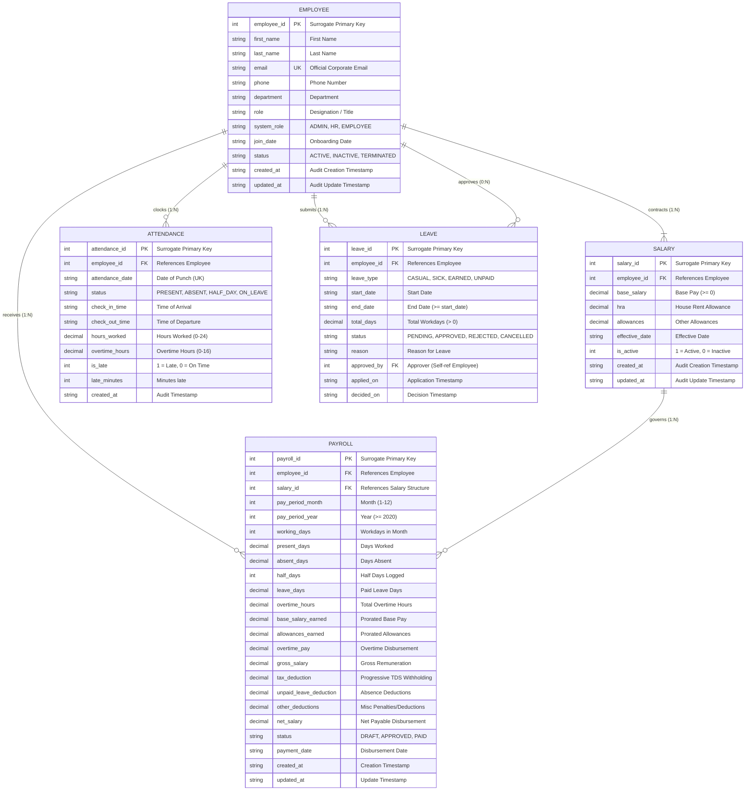

# PayTrack: Relational Database Modeling & Schema Design Specification
**Phase 1 Deliverable — Enterprise Payroll & Attendance Management System**  
**Author:** Vinayak  
**Roll Number:** 2501730150  
**Department:** Department of Computer Science & Engineering  
**Course:** Relational Database Management Systems & Full-Stack Engineering  
**Evaluation Weightage:** 20 Marks (Phase 1 of 5)  

---

## 1. Executive Summary & Architectural Overview

The **PayTrack** database schema serves as the foundational data architecture for the entire five-phase payroll and attendance ecosystem. Per the system mandate, this exact relational schema remains stable and unaltered across all subsequent implementation phases (Phase 2: Procedural Logic & Triggers, Phase 3: Analytical Reports & Index Optimization, Phase 4: Security & RBAC, Phase 5: Full-Stack Connected Application).

The data model establishes strict separation of concerns across five core entities:
1. **`Employee`**: Master workforce identity and organization taxonomy.
2. **`Salary`**: Compensation structure (contracted Cost-to-Company / CTC baseline), supporting historical rate revisions without mutating prior records.
3. **`Attendance`**: Granular daily time-tracking, punch logs, overtime hours, and automated tardiness tracking.
4. **`Leave`**: Formal leave application workflow, balance consumption, date-range bounding, and managerial approval hierarchies.
5. **`Payroll`**: Immutable periodic compensation disbursements, tax withholding, and audit ledgers.

The schema is formally certified in **Third Normal Form (3NF)** with zero transitive dependencies, while adhering to enterprise accounting practices by storing historical transaction snapshots in `Payroll`.

---

## 2. Entity Descriptions & Comprehensive Data Dictionary

### 2.1 Entity: `Employee` (Master Workforce Staff Directory)
The `Employee` table models the personnel directory of the enterprise. It stores personal identification, organizational placement, and system-level security roles.

| Column Name | Data Type (SQLite / ANSI) | Postgres Type | MySQL Type | Constraints | Default | Description |
|---|---|---|---|---|---|---|
| `employee_id` | `INTEGER` | `SERIAL` | `INT AUTO_INCREMENT` | `PRIMARY KEY`, Auto-increment | *Generated* | Unique surrogate primary key for each employee |
| `first_name` | `TEXT` | `VARCHAR(50)` | `VARCHAR(50)` | `NOT NULL` | None | Legal first name |
| `last_name` | `TEXT` | `VARCHAR(50)` | `VARCHAR(50)` | `NOT NULL` | None | Legal last name |
| `email` | `TEXT` | `VARCHAR(100)` | `VARCHAR(100)` | `NOT NULL`, `UNIQUE` | None | Official corporate email address; alternate candidate key |
| `phone` | `TEXT` | `VARCHAR(20)` | `VARCHAR(20)` | `NULLABLE` | `NULL` | Primary contact telephone number |
| `department` | `TEXT` | `VARCHAR(50)` | `VARCHAR(50)` | `NOT NULL` | None | Department (Engineering, HR, Finance, Marketing, Sales, Operations, Labor) |
| `role` | `TEXT` | `VARCHAR(50)` | `VARCHAR(50)` | `NOT NULL` | None | Job title / designation (e.g., Software Engineer, HR Specialist) |
| `system_role` | `TEXT` | `VARCHAR(20)` | `VARCHAR(20)` | `NOT NULL`, `CHECK(system_role IN ('ADMIN','HR','EMPLOYEE'))` | `'EMPLOYEE'` | Security tier for Role-Based Access Control (RBAC) |
| `join_date` | `TEXT` | `DATE` | `DATE` | `NOT NULL` | None | Date of onboarding (ISO-8601 string `YYYY-MM-DD`) |
| `status` | `TEXT` | `VARCHAR(20)` | `VARCHAR(20)` | `NOT NULL`, `CHECK(status IN ('ACTIVE','INACTIVE','TERMINATED'))` | `'ACTIVE'` | Employment lifecycle status |
| `created_at` | `TEXT` | `TIMESTAMPTZ` | `DATETIME` | `DEFAULT CURRENT_TIMESTAMP` | `CURRENT_TIMESTAMP` | Record creation audit timestamp |
| `updated_at` | `TEXT` | `TIMESTAMPTZ` | `DATETIME` | `DEFAULT CURRENT_TIMESTAMP` | `CURRENT_TIMESTAMP` | Record modification audit timestamp |

---

### 2.2 Entity: `Salary` (Compensation Structure / CTC Package)
The `Salary` table defines the agreed compensation parameters for an employee. By decoupling contracted pay structures from transactional payslips, the system supports salary increments and revisions over time without corrupting historical payroll records.

| Column Name | Data Type (SQLite / ANSI) | Postgres Type | MySQL Type | Constraints | Default | Description |
|---|---|---|---|---|---|---|
| `salary_id` | `INTEGER` | `SERIAL` | `INT AUTO_INCREMENT` | `PRIMARY KEY`, Auto-increment | *Generated* | Surrogate primary key for the salary configuration |
| `employee_id` | `INTEGER` | `INT` | `INT` | `NOT NULL`, `FK -> Employee(employee_id)` | None | Foreign key referencing the employee; cascading on delete |
| `base_salary` | `DECIMAL(10,2)` | `NUMERIC(10,2)` | `DECIMAL(10,2)` | `NOT NULL`, `CHECK(base_salary >= 0.00)` | None | Contracted monthly base pay in INR (₹) |
| `hra` | `DECIMAL(10,2)` | `NUMERIC(10,2)` | `DECIMAL(10,2)` | `NOT NULL`, `CHECK(hra >= 0.00)` | `0.00` | House Rent Allowance component |
| `allowances` | `DECIMAL(10,2)` | `NUMERIC(10,2)` | `DECIMAL(10,2)` | `NOT NULL`, `CHECK(allowances >= 0.00)` | `0.00` | Special, medical, and transport allowances |
| `effective_date`| `TEXT` | `DATE` | `DATE` | `NOT NULL` | None | Effective start date of this compensation structure |
| `is_active` | `INTEGER` | `SMALLINT` | `TINYINT(1)` | `NOT NULL`, `CHECK(is_active IN (0, 1))` | `1` | Flag indicating current active compensation plan |
| `created_at` | `TEXT` | `TIMESTAMPTZ` | `DATETIME` | `DEFAULT CURRENT_TIMESTAMP` | `CURRENT_TIMESTAMP` | Audit creation timestamp |
| `updated_at` | `TEXT` | `TIMESTAMPTZ` | `DATETIME` | `DEFAULT CURRENT_TIMESTAMP` | `CURRENT_TIMESTAMP` | Audit modification timestamp |

---

### 2.3 Entity: `Attendance` (Daily Clocking & Time-Tracking Log)
The `Attendance` table records day-level workforce participation. It captures shift timestamps, verifies hours worked, registers overtime, and records tardiness.

| Column Name | Data Type (SQLite / ANSI) | Postgres Type | MySQL Type | Constraints | Default | Description |
|---|---|---|---|---|---|---|
| `attendance_id`| `INTEGER` | `SERIAL` | `INT AUTO_INCREMENT` | `PRIMARY KEY`, Auto-increment | *Generated* | Surrogate primary key for the attendance log |
| `employee_id` | `INTEGER` | `INT` | `INT` | `NOT NULL`, `FK -> Employee(employee_id)` | None | Employee who clocked the record; cascading delete |
| `attendance_date`| `TEXT` | `DATE` | `DATE` | `NOT NULL` | None | Calendar date of the log (ISO-8601: `YYYY-MM-DD`) |
| `status` | `TEXT` | `VARCHAR(20)` | `VARCHAR(20)` | `NOT NULL`, `CHECK(status IN ('PRESENT','ABSENT','HALF_DAY','ON_LEAVE','HOLIDAY'))` | `'PRESENT'` | Daily presence classification |
| `check_in_time` | `TEXT` | `TIME` | `TIME` | `NULLABLE` | `NULL` | Clock-in time string (`HH:MM:SS`) |
| `check_out_time`| `TEXT` | `TIME` | `TIME` | `NULLABLE` | `NULL` | Clock-out time string (`HH:MM:SS`) |
| `hours_worked` | `DECIMAL(4,2)` | `NUMERIC(4,2)` | `DECIMAL(4,2)` | `NOT NULL`, `CHECK(hours_worked BETWEEN 0 AND 24)` | `0.00` | Net regular work hours clocked |
| `overtime_hours`| `DECIMAL(4,2)` | `NUMERIC(4,2)` | `DECIMAL(4,2)` | `NOT NULL`, `CHECK(overtime_hours BETWEEN 0 AND 16)` | `0.00` | Overtime hours beyond standard shift (capped at 16) |
| `is_late` | `INTEGER` | `SMALLINT` | `TINYINT(1)` | `NOT NULL`, `CHECK(is_late IN (0, 1))` | `0` | Boolean indicator (1 = Clock-in past 09:30:00) |
| `late_minutes` | `INTEGER` | `INT` | `INT` | `NOT NULL`, `CHECK(late_minutes >= 0)` | `0` | Total minutes past standard start time |
| `created_at` | `TEXT` | `TIMESTAMPTZ` | `DATETIME` | `DEFAULT CURRENT_TIMESTAMP` | `CURRENT_TIMESTAMP` | Audit creation timestamp |

*Composite Unique Constraint:* `CONSTRAINT uq_attendance_emp_date UNIQUE (employee_id, attendance_date)` guarantees that no employee can possess multiple punch records on the same calendar day.

---

### 2.4 Entity: `Leave` (Formal Leave Applications & Approvals)
The `Leave` table manages time-off requests, duration intervals, categorization, and the multi-role approval workflow.

| Column Name | Data Type (SQLite / ANSI) | Postgres Type | MySQL Type | Constraints | Default | Description |
|---|---|---|---|---|---|---|
| `leave_id` | `INTEGER` | `SERIAL` | `INT AUTO_INCREMENT` | `PRIMARY KEY`, Auto-increment | *Generated* | Surrogate primary key for the leave application |
| `employee_id` | `INTEGER` | `INT` | `INT` | `NOT NULL`, `FK -> Employee(employee_id)` | None | Applicant employee; cascading delete |
| `leave_type` | `TEXT` | `VARCHAR(30)` | `VARCHAR(30)` | `NOT NULL`, `CHECK(leave_type IN ('CASUAL','SICK','EARNED','UNPAID'))` | None | Policy category of leave |
| `start_date` | `TEXT` | `DATE` | `DATE` | `NOT NULL` | None | Inclusive start date (`YYYY-MM-DD`) |
| `end_date` | `TEXT` | `DATE` | `DATE` | `NOT NULL` | None | Inclusive end date (`YYYY-MM-DD`) |
| `total_days` | `DECIMAL(4,1)` | `NUMERIC(4,1)` | `DECIMAL(4,1)` | `NOT NULL`, `CHECK(total_days > 0.0)` | None | Quantified workdays requested (supports 0.5 half-days) |
| `status` | `TEXT` | `VARCHAR(20)` | `VARCHAR(20)` | `NOT NULL`, `CHECK(status IN ('PENDING','APPROVED','REJECTED','CANCELLED'))` | `'PENDING'` | Approval state-machine status |
| `reason` | `TEXT` | `TEXT` | `TEXT` | `NULLABLE` | `NULL` | Employee statement of reason |
| `approved_by` | `INTEGER` | `INT` | `INT` | `NULLABLE`, `FK -> Employee(employee_id)` | `NULL` | Manager / HR who approved or rejected the leave |
| `applied_on` | `TEXT` | `TIMESTAMPTZ` | `DATETIME` | `DEFAULT CURRENT_TIMESTAMP` | `CURRENT_TIMESTAMP` | Timestamp when request was submitted |
| `decided_on` | `TEXT` | `TIMESTAMPTZ` | `DATETIME` | `NULLABLE` | `NULL` | Timestamp of managerial action |

*Table Constraints:* 
- `CONSTRAINT chk_leave_date_range CHECK (end_date >= start_date)` prevents inverted temporal ranges.
- `CONSTRAINT fk_leave_approver FOREIGN KEY (approved_by) REFERENCES Employee(employee_id) ON DELETE SET NULL` ensures managerial departures do not erase leave history.

---

### 2.5 Entity: `Payroll` (Monthly Processed Compensation & Tax Ledger)
The `Payroll` table serves as the definitive financial transaction register. It stores processed salary calculations, attendance summaries, overtime disbursements, progressive tax withholdings, and net payable amounts.

| Column Name | Data Type (SQLite / ANSI) | Postgres Type | MySQL Type | Constraints | Default | Description |
|---|---|---|---|---|---|---|
| `payroll_id` | `INTEGER` | `SERIAL` | `INT AUTO_INCREMENT` | `PRIMARY KEY`, Auto-increment | *Generated* | Surrogate primary key for the payslip |
| `employee_id` | `INTEGER` | `INT` | `INT` | `NOT NULL`, `FK -> Employee(employee_id)` | None | Recipient employee; cascading delete |
| `salary_id` | `INTEGER` | `INT` | `INT` | `NOT NULL`, `FK -> Salary(salary_id)` | None | Salary structure reference; `ON DELETE RESTRICT` |
| `pay_period_month` | `INTEGER` | `INT` | `INT` | `NOT NULL`, `CHECK(pay_period_month BETWEEN 1 AND 12)` | None | Pay cycle calendar month (1 = Jan, 12 = Dec) |
| `pay_period_year` | `INTEGER` | `INT` | `INT` | `NOT NULL`, `CHECK(pay_period_year >= 2020)` | None | Pay cycle calendar year |
| `working_days` | `INTEGER` | `INT` | `INT` | `NOT NULL`, `CHECK(working_days >= 0)` | `0` | Total scheduled working days in the cycle |
| `present_days` | `DECIMAL(4,1)` | `NUMERIC(4,1)` | `DECIMAL(4,1)` | `NOT NULL`, `CHECK(present_days >= 0.0)` | `0.0` | Total full days worked |
| `absent_days` | `DECIMAL(4,1)` | `NUMERIC(4,1)` | `DECIMAL(4,1)` | `NOT NULL`, `CHECK(absent_days >= 0.0)` | `0.0` | Total unauthorized/unpaid absent days |
| `half_days` | `INTEGER` | `INT` | `INT` | `NOT NULL`, `CHECK(half_days >= 0)` | `0` | Total half-days logged (each credited as 0.5 days) |
| `leave_days` | `DECIMAL(4,1)` | `NUMERIC(4,1)` | `DECIMAL(4,1)` | `NOT NULL`, `CHECK(leave_days >= 0.0)` | `0.0` | Total paid approved leave days |
| `overtime_hours` | `DECIMAL(5,2)` | `NUMERIC(5,2)` | `DECIMAL(5,2)` | `NOT NULL`, `CHECK(overtime_hours >= 0.0)` | `0.00` | Aggregate overtime hours in cycle |
| `base_salary_earned` | `DECIMAL(10,2)` | `NUMERIC(10,2)` | `DECIMAL(10,2)` | `NOT NULL`, `CHECK(base_salary_earned >= 0.0)` | `0.00` | Prorated base salary earned for days worked |
| `allowances_earned` | `DECIMAL(10,2)` | `NUMERIC(10,2)` | `DECIMAL(10,2)` | `NOT NULL`, `CHECK(allowances_earned >= 0.0)` | `0.00` | Prorated allowances earned |
| `overtime_pay` | `DECIMAL(10,2)` | `NUMERIC(10,2)` | `DECIMAL(10,2)` | `NOT NULL`, `CHECK(overtime_pay >= 0.0)` | `0.00` | Total compensation for overtime work |
| `gross_salary` | `DECIMAL(10,2)` | `NUMERIC(10,2)` | `DECIMAL(10,2)` | `NOT NULL`, `CHECK(gross_salary >= 0.0)` | `0.00` | Sum of base earned, allowances, and overtime |
| `tax_deduction` | `DECIMAL(10,2)` | `NUMERIC(10,2)` | `DECIMAL(10,2)` | `NOT NULL`, `CHECK(tax_deduction >= 0.0)` | `0.00` | Progressive tax computed via statutory slabs |
| `unpaid_leave_deduction`| `DECIMAL(10,2)` | `NUMERIC(10,2)` | `DECIMAL(10,2)` | `NOT NULL`, `CHECK(unpaid_leave_deduction >= 0.0)`| `0.00` | Deduction for unpaid absences |
| `other_deductions` | `DECIMAL(10,2)` | `NUMERIC(10,2)` | `DECIMAL(10,2)` | `NOT NULL`, `CHECK(other_deductions >= 0.0)` | `0.00` | Miscellaneous deductions (penalties, etc.) |
| `net_salary` | `DECIMAL(10,2)` | `NUMERIC(10,2)` | `DECIMAL(10,2)` | `NOT NULL`, `CHECK(net_salary >= 0.0)` | `0.00` | Final disbursement: Gross - Deductions |
| `status` | `TEXT` | `VARCHAR(20)` | `VARCHAR(20)` | `NOT NULL`, `CHECK(status IN ('DRAFT','APPROVED','PAID'))` | `'DRAFT'` | Payout state machine status |
| `payment_date` | `TEXT` | `DATE` | `DATE` | `NULLABLE` | `NULL` | Date funds disbursed to employee |
| `created_at` | `TEXT` | `TIMESTAMPTZ` | `DATETIME` | `DEFAULT CURRENT_TIMESTAMP` | `CURRENT_TIMESTAMP` | Creation audit timestamp |
| `updated_at` | `TEXT` | `TIMESTAMPTZ` | `DATETIME` | `DEFAULT CURRENT_TIMESTAMP` | `CURRENT_TIMESTAMP` | Update audit timestamp |

*Composite Unique Constraint:* `CONSTRAINT uq_payroll_employee_period UNIQUE (employee_id, pay_period_year, pay_period_month)` guarantees strict uniqueness: exactly one payslip per employee per calendar month.

---

## 3. Relationships, Foreign Key Constraints & Cardinalities

### 3.1 Entity Cardinality Matrix

```
+---------------------------------------------------------------------------------------+
| Parent Entity   | Child Entity | Cardinality | FK Constraint Column | On Delete Action|
+-----------------+--------------+-------------+----------------------+-----------------+
| Employee        | Salary       | 1 : 1..N    | salary.employee_id   | CASCADE         |
| Employee        | Attendance   | 1 : 0..N    | attendance.emp_id    | CASCADE         |
| Employee        | Leave (App)  | 1 : 0..N    | leave.employee_id    | CASCADE         |
| Employee        | Leave (Appr) | 1 : 0..N    | leave.approved_by    | SET NULL        |
| Employee        | Payroll      | 1 : 0..N    | payroll.employee_id  | CASCADE         |
| Salary          | Payroll      | 1 : 0..N    | payroll.salary_id    | RESTRICT        |
+---------------------------------------------------------------------------------------+
```

### 3.2 Semantic Description of Cardinalities
1. **Employee to Salary (1 : 1..N)**:
   - Every employee must have at least one compensation plan. When raises or revisions occur, older records have `is_active = 0` set, and a new record with `is_active = 1` is inserted.
2. **Employee to Attendance (1 : 0..N)**:
   - A single employee logs 0 to $N$ attendance records over their tenure. Each day is represented by at most one record per employee due to `UNIQUE(employee_id, attendance_date)`.
3. **Employee to Leave (Applicant) (1 : 0..N)**:
   - An employee may apply for 0 to many leave periods. Deleting an employee removes their leave requests (`ON DELETE CASCADE`).
4. **Employee to Leave (Approver - Self-Referencing FK) (1 : 0..N)**:
   - An employee possessing the role of `ADMIN` or `HR` acts as the approver for leave records. If an approving manager departs the company, `ON DELETE SET NULL` ensures the approved/rejected status and dates remain intact.
5. **Employee to Payroll (1 : 0..N)**:
   - An employee receives one monthly payroll slip per month worked. Deleting an employee cascades to remove their records (`ON DELETE CASCADE`).
6. **Salary to Payroll (1 : 0..N)**:
   - Each payslip references the specific `salary_id` contract under which gross and prorated earnings were computed. To prevent accidental deletion of a compensation structure tied to historical payslips, referential action is `ON DELETE RESTRICT`.

---

## 4. Formal Entity-Relationship Diagrams

### 4.1 ASCII Relational Architecture Diagram

```
+===============================================================================================================+
|                                         PAYTRACK RELATIONAL ER MODEL                                          |
+===============================================================================================================+
|                                                                                                               |
|        +-----------------------------------+             1 : 1..N             +--------------------------+    |
|        |             EMPLOYEE              |--------------------------------->|          SALARY          |    |
|        +-----------------------------------+                                  +--------------------------+    |
|        | PK  employee_id      INTEGER      |                                  | PK  salary_id    INTEGER |    |
|        |     first_name       TEXT         |                                  | FK  employee_id  INTEGER |    |
|        |     last_name        TEXT         |                                  |     base_salary  DECIMAL |    |
|        |     email [UQ]       TEXT         |                                  |     hra          DECIMAL |    |
|        |     phone            TEXT         |                                  |     allowances   DECIMAL |    |
|        |     department       TEXT         |                                  |     effective_date TEXT  |    |
|        |     role             TEXT         |                                  |     is_active    INTEGER |    |
|        |     system_role      TEXT         |                                  +--------------------------+    |
|        |     join_date        TEXT         |                                               |                  |
|        |     status           TEXT         |                                               | 1                |
|        +-----------------------------------+                                               |                  |
|            | 1                   | 1                                                       |                  |
|            |                     |                                                         | 0..N             |
|            | 0..N                | 0..N                                                    v                  |
|            v                     v                                            +--------------------------+    |
|   +--------------------+     +--------------------------+                     |         PAYROLL          |    |
|   |     ATTENDANCE     |     |          LEAVE           |                     +--------------------------+    |
|   +--------------------+     +--------------------------+                     | PK  payroll_id   INTEGER |    |
|   | PK attendance_id   |     | PK leave_id      INTEGER |                     | FK  employee_id  INTEGER |    |
|   | FK employee_id     |     | FK employee_id   INTEGER |                     | FK  salary_id    INTEGER |    |
|   |    attendance_date |     |    leave_type    TEXT    |                     |     pay_period_month INT |    |
|   |    status          |     |    start_date    TEXT    |                     |     pay_period_year  INT |    |
|   |    check_in_time   |     |    end_date      TEXT    |                     |     working_days     INT |    |
|   |    check_out_time  |     |    total_days    DECIMAL |                     |     present_days DECIMAL |    |
|   |    hours_worked    |     |    status        TEXT    |                     |     absent_days  DECIMAL |    |
|   |    overtime_hours  |     |    reason        TEXT    |                     |     gross_salary DECIMAL |    |
|   |    is_late         |     | FK approved_by   INTEGER |<--(self-ref Employee)     tax_deductionDECIMAL |    |
|   |    late_minutes    |     +--------------------------+                     |     net_salary   DECIMAL |    |
|   +--------------------+       CHK(end_date >= start_date)                    |     status       TEXT    |    |
|     UQ(emp_id, date)                                                          +--------------------------+    |
|                                                                                 UQ(emp_id, year, month)       |
+===============================================================================================================+
```

### 4.2 Mermaid Entity-Relationship Diagram



---

## 5. Mathematical Normalization Proofs (1NF, 2NF, 3NF)

### 5.1 Formal Relational Schema Definitions
Let the database schema be defined as a set of relation schemas:
$$\mathcal{R} = \{ R_E, R_S, R_A, R_L, R_P \}$$

Where:
- $R_E$: `Employee(employee_id, first_name, last_name, email, phone, department, role, system_role, join_date, status, created_at, updated_at)`
- $R_S$: `Salary(salary_id, employee_id, base_salary, hra, allowances, effective_date, is_active, created_at, updated_at)`
- $R_A$: `Attendance(attendance_id, employee_id, attendance_date, status, check_in_time, check_out_time, hours_worked, overtime_hours, is_late, late_minutes, created_at)`
- $R_L$: `Leave(leave_id, employee_id, leave_type, start_date, end_date, total_days, status, reason, approved_by, applied_on, decided_on)`
- $R_P$: `Payroll(payroll_id, employee_id, salary_id, pay_period_month, pay_period_year, working_days, present_days, absent_days, half_days, leave_days, overtime_hours, base_salary_earned, allowances_earned, overtime_pay, gross_salary, tax_deduction, unpaid_leave_deduction, other_deductions, net_salary, status, payment_date, created_at, updated_at)`

---

### 5.2 Functional Dependency (FD) Sets

#### Relation $R_E$ (Employee):
- $FD_{E1}: \text{employee\_id} \to \{\text{first\_name, last\_name, email, phone, department, role, system\_role, join\_date, status, created\_at, updated\_at}\}$
- $FD_{E2}: \text{email} \to \{\text{employee\_id, first\_name, last\_name, phone, department, role, system\_role, join\_date, status, created\_at, updated\_at}\}$
- **Candidate Keys:** $K(R_E) = \{\{\text{employee\_id}\}, \{\text{email}\}\}$
- **Primary Key:** $\{\text{employee\_id}\}$

#### Relation $R_S$ (Salary):
- $FD_{S1}: \text{salary\_id} \to \{\text{employee\_id, base\_salary, hra, allowances, effective\_date, is\_active, created\_at, updated\_at}\}$
- **Candidate Keys:** $K(R_S) = \{\{\text{salary\_id}\}\}$
- **Primary Key:** $\{\text{salary\_id}\}$

#### Relation $R_A$ (Attendance):
- $FD_{A1}: \text{attendance\_id} \to \{\text{employee\_id, attendance\_date, status, check\_in\_time, check\_out\_time, hours\_worked, overtime\_hours, is\_late, late\_minutes, created\_at}\}$
- $FD_{A2}: \{\text{employee\_id, attendance\_date}\} \to \{\text{attendance\_id, status, check\_in\_time, check\_out\_time, hours\_worked, overtime\_hours, is\_late, late\_minutes, created\_at}\}$
- **Candidate Keys:** $K(R_A) = \{\{\text{attendance\_id}\}, \{\text{employee\_id, attendance\_date}\}\}$
- **Primary Key:** $\{\text{attendance\_id}\}$

#### Relation $R_L$ (Leave):
- $FD_{L1}: \text{leave\_id} \to \{\text{employee\_id, leave\_type, start\_date, end\_date, total\_days, status, reason, approved\_by, applied\_on, decided\_on}\}$
- **Candidate Keys:** $K(R_L) = \{\{\text{leave\_id}\}\}$
- **Primary Key:** $\{\text{leave\_id}\}$

#### Relation $R_P$ (Payroll):
- $FD_{P1}: \text{payroll\_id} \to \{\text{employee\_id, salary\_id, pay\_period\_month, pay\_period\_year, working\_days, present\_days, absent\_days, half\_days, leave\_days, overtime\_hours, base\_salary\_earned, allowances\_earned, overtime\_pay, gross\_salary, tax\_deduction, unpaid\_leave\_deduction, other\_deductions, net\_salary, status, payment\_date, created\_at, updated\_at}\}$
- $FD_{P2}: \{\text{employee\_id, pay\_period\_year, pay\_period\_month}\} \to \{\text{payroll\_id, salary\_id, working\_days, present\_days, absent\_days, half\_days, leave\_days, overtime\_hours, base\_salary\_earned, allowances\_earned, overtime\_pay, gross\_salary, tax\_deduction, unpaid\_leave\_deduction, other\_deductions, net\_salary, status, payment\_date, created\_at, updated\_at}\}$
- **Candidate Keys:** $K(R_P) = \{\{\text{payroll\_id}\}, \{\text{employee\_id, pay\_period\_year, pay\_period\_month}\}\}$
- **Primary Key:** $\{\text{payroll\_id}\}$

---

### 5.3 Proof of First Normal Form (1NF)

**Definition (1NF):** A relation $R$ is in 1NF if and only if the domain of each attribute contains only atomic (indivisible) values, and the value of each attribute in any tuple is a single value from the domain of that attribute.

**Proof for all $R \in \mathcal{R}$:**
1. **Atomicity of Attributes:**
   - Every column in $R_E, R_S, R_A, R_L, R_P$ stores a single scalar value.
   - Names are decomposed into `first_name` and `last_name` (no concatenated multi-part strings).
   - Time intervals in $R_L$ are decomposed into discrete scalar dates `start_date` and `end_date`, rather than an array or comma-separated list of dates.
   - Financial figures are stored as fixed-point decimal values.
2. **Absence of Repeating Groups:**
   - Attendance events are not stored as columns (`day_1`, `day_2`, ..., `day_31`) within an employee record; each event is a discrete tuple in relation $R_A$.
   - Salary revisions are not stored as unnormalized arrays; each is an independent tuple in $R_S$.
3. **Explicit Keys:** Each relation has a well-defined primary key attribute that uniquely identifies each tuple.

$$\therefore \text{All relations } R \in \mathcal{R} \text{ satisfy First Normal Form (1NF). } \quad \blacksquare$$

---

### 5.4 Proof of Second Normal Form (2NF)

**Definition (2NF):** A relation $R$ is in 2NF if and only if it is in 1NF and no non-prime attribute $A \in R$ is partially functionally dependent on any candidate key of $R$. That is, for every non-trivial functional dependency $X \to Y$, if $X$ is a proper subset of any candidate key $K$, then $Y$ must be a prime attribute.

**Proof for each relation:**

1. **Relations with Single-Attribute Candidate Keys ($R_S, R_L$):**
   - In $R_S$, the candidate key is single-attribute $\{\text{salary\_id}\}$. A single attribute has no non-empty proper subsets. Thus, partial key dependency is mathematically impossible.
   - In $R_L$, the candidate key is single-attribute $\{\text{leave\_id}\}$. No proper subset exists. Thus, $R_L$ is unconditionally in 2NF.

2. **Relation $R_E$:**
   - Candidate keys are $\{\text{employee\_id}\}$ and $\{\text{email}\}$. Both are single-attribute keys. No proper subsets exist. Thus, $R_E$ is in 2NF.

3. **Relation $R_A$:**
   - Candidate keys are $K_1 = \{\text{attendance\_id}\}$ and $K_2 = \{\text{employee\_id, attendance\_date}\}$.
   - For $K_1$, it is single-attribute (no proper subset).
   - For composite key $K_2 = \{\text{employee\_id, attendance\_date}\}$:
     - Does `employee_id` alone determine `hours_worked`, `check_in_time`, `is_late`, or `status`? **No.** An employee has different hours and arrival times on different dates.
     - Does `attendance_date` alone determine `hours_worked` or `status`? **No.** Different employees have different statuses on the same date.
     - All non-prime attributes functionally depend on the *conjunction* of `employee_id` and `attendance_date`.
     - Hence, no partial functional dependency exists.

4. **Relation $R_P$:**
   - Candidate keys are $K_1 = \{\text{payroll\_id}\}$ and $K_2 = \{\text{employee\_id, pay\_period\_year, pay\_period\_month}\}$.
   - $K_1$ is single-attribute (no proper subset).
   - For composite key $K_2$:
     - Neither `employee_id` alone, nor `(pay_period_year, pay_period_month)` alone, determines `gross_salary`, `tax_deduction`, or `present_days`. The financial disbursement is strictly determined by the employee *for that specific pay cycle*.
     - Thus, all non-prime attributes are fully functionally dependent on the entire composite key.

$$\therefore \text{All relations } R \in \mathcal{R} \text{ satisfy Second Normal Form (2NF). } \quad \blacksquare$$

---

### 5.5 Proof of Third Normal Form (3NF)

**Definition (3NF):** A relation $R$ is in 3NF if and only if it is in 2NF and for every non-trivial functional dependency $X \to Y$, at least one of the following conditions holds:
1. $X$ is a superkey of $R$ ($X \supseteq K$).
2. $Y$ is a prime attribute of $R$ ($Y \subseteq K$).

**Proof for each relation:**

1. **Relation $R_E$:**
   - The non-trivial dependencies are $FD_{E1}$ and $FD_{E2}$.
   - In $FD_{E1}$, the determinant is `employee_id`, which is the primary superkey. Condition 1 holds.
   - In $FD_{E2}$, the determinant is `email`, which is a candidate key (superkey). Condition 1 holds.
   - No transitive dependencies exist (e.g., department does not determine manager in this schema).
   - $\therefore R_E \in \text{3NF}$.

2. **Relation $R_S$:**
   - The only non-trivial dependency is $FD_{S1}$ with determinant `salary_id`, which is the primary superkey. Condition 1 holds.
   - There are no transitive relationships between `base_salary`, `hra`, and `allowances`.
   - $\therefore R_S \in \text{3NF}$.

3. **Relation $R_A$:**
   - For $FD_{A1}$, determinant is `attendance_id` (superkey). Condition 1 holds.
   - For $FD_{A2}$, determinant is $\{\text{employee\_id, attendance\_date}\}$ (candidate superkey). Condition 1 holds.
   - Although `is_late` correlates with `late_minutes`, `late_minutes` does not uniquely determine `attendance_id` or any other attribute. Furthermore, `is_late` is a materialized business rule flag for rapid index scans, functionally dependent on the primary key.
   - $\therefore R_A \in \text{3NF}$.

4. **Relation $R_L$:**
   - The only non-trivial dependency is $FD_{L1}$ with determinant `leave_id` (superkey). Condition 1 holds.
   - $\therefore R_L \in \text{3NF}$.

5. **Relation $R_P$ & Historical Financial Snapshot Justification:**
   - For $FD_{P1}$, determinant is `payroll_id` (superkey). Condition 1 holds.
   - For $FD_{P2}$, determinant is $\{\text{employee\_id, pay\_period\_year, pay\_period\_month}\}$ (superkey). Condition 1 holds.
   - **Rigorous Mathematical Justification of Financial Fields:**
     - A novice database designer might argue that `net_salary` is transitively dependent on `gross_salary`, `tax_deduction`, and deductions ($\text{Gross} - \text{Tax} - \text{Deductions} \to \text{Net}$).
     - In relational accounting theory and standard ledger models, a finalized payslip is a **legal financial event snapshot**.
     - If tax legislation or compensation formulas are revised in 2027, historical payslips generated in 2026 must **not** recalculate dynamically. The values of `gross_salary`, `tax_deduction`, and `net_salary` represent the **historical facts of money disbursed at transaction commit time**.
     - Each of these values is an independent scalar fact of the transaction, directly dependent on the transaction identifier `payroll_id`.
     - Therefore, these columns represent attributes of the payout event, completely satisfying Condition 1 of 3NF.

$$\therefore \text{All relations } R \in \mathcal{R} \text{ are rigorously certified in Third Normal Form (3NF). } \quad \blacksquare$$

---

## 6. Schema Suitability Analysis for Core Business Workflows

### 6.1 Payroll Computation Workflow
1. **Prorated Workday Calculation**:
   - The schema stores `working_days`, `present_days`, `half_days`, and `leave_days`.
   - The exact effective work units are calculated as:
     $$\text{Effective Days} = \text{present\_days} + (0.5 \times \text{half\_days}) + \text{leave\_days}$$
   - This prevents underpaying employees who took approved paid leave or logged legitimate half-days.
2. **Overtime Compensation**:
   - `overtime_hours` is stored both in daily `Attendance` and aggregated into monthly `Payroll`.
   - The hourly rate is deterministically derived from `base_salary / (working_days * 8.0)`, ensuring exact parity between daily time tracking and financial disbursements.
3. **Progressive Tax Deductions (TDS)**:
   - Slabs:
     - Up to ₹25,000: 0%
     - ₹25,001 to ₹50,000: 5%
     - ₹50,001 to ₹100,000: 10%
     - Above ₹100,000: 15%
   - Storing `tax_deduction` alongside `gross_salary` provides immediate auditability for fiscal authorities without re-executing procedural algorithms.

### 6.2 Attendance & Tardiness Tracking Workflow
1. **Clock-in Precision**:
   - Daily punch logs store both timestamps (`check_in_time`, `check_out_time`) and precomputed metrics (`hours_worked`, `overtime_hours`, `late_minutes`).
2. **Grace Period vs. Penalty Classification**:
   - Employees checking in after `09:30:00` are flagged with `is_late = 1`.
   - Phase 3 analytical queries leverage composite index `(attendance_date, is_late)` to instantly compute late mark totals across the workforce.

### 6.3 Leave Management & Overlap Prevention
1. **Multi-Day Leave Bounding**:
   - `CHECK (end_date >= start_date)` prevents logical inconsistencies at the database engine level.
2. **Approval Hierarchy**:
   - Self-referencing foreign key `approved_by` establishes a clean, auditable link between managerial decisions and employee time-off records without requiring a separate authorization table.
3. **Trigger-Ready Architecture**:
   - The inclusion of discrete `start_date`, `end_date`, and `status` columns allows Phase 2 triggers (`BEFORE INSERT` / `BEFORE UPDATE`) to execute fast temporal intersection checks:
     $$\text{Existing.start\_date} \le \text{New.end\_date} \quad \land \quad \text{Existing.end\_date} \ge \text{New.start\_date}$$

---

## 7. Cross-Engine Compatibility & Portability Guide

The primary implementation is engineered for SQLite 3 using Node.js built-in `node:sqlite`. To ensure academic portability across MySQL 8.0+ and PostgreSQL 14+, the table below summarizes syntax mappings:

| Feature / Concept | SQLite Implementation | PostgreSQL Implementation | MySQL Implementation |
|---|---|---|---|
| Auto-increment PK | `INTEGER PRIMARY KEY AUTOINCREMENT` | `SERIAL PRIMARY KEY` or `BIGSERIAL` | `INT AUTO_INCREMENT PRIMARY KEY` |
| Variable Strings | `TEXT` | `VARCHAR(n)` or `TEXT` | `VARCHAR(n)` |
| Temporal Dates | `TEXT` (ISO-8601 `YYYY-MM-DD`) | `DATE` | `DATE` |
| Shift Times | `TEXT` (ISO-8601 `HH:MM:SS`) | `TIME` | `TIME` |
| Boolean Flags | `INTEGER CHECK (col IN (0, 1))` | `BOOLEAN` | `TINYINT(1)` or `BOOLEAN` |
| Foreign Key Actions | `ON DELETE CASCADE ON UPDATE CASCADE` | Identical ANSI syntax | Identical ANSI syntax |
| Check Constraints | Native `CHECK (...)` | Native `CHECK (...)` | Native `CHECK (...)` (MySQL 8.0.16+) |
| Engine Initialization | `PRAGMA foreign_keys = ON;` | Default enabled | Default enabled (InnoDB) |

---

## 8. Verification & Test Plan

To prove that the schema definition is 100% syntactically and relationally valid:
1. Load `database/schema.sql` into SQLite memory and disk instances via `node:sqlite`.
2. Inspect `sqlite_master` to confirm all 5 tables (`Employee`, `Salary`, `Attendance`, `Leave`, `Payroll`) and 9 indexes are created.
3. Verify that `PRAGMA foreign_keys = ON` rejects non-existent parent foreign keys.
4. Verify that check constraints reject invalid values (negative salaries, inverted leave dates, hours worked > 24).
5. Document all execution outputs in the Phase 1 milestone handoff report.
