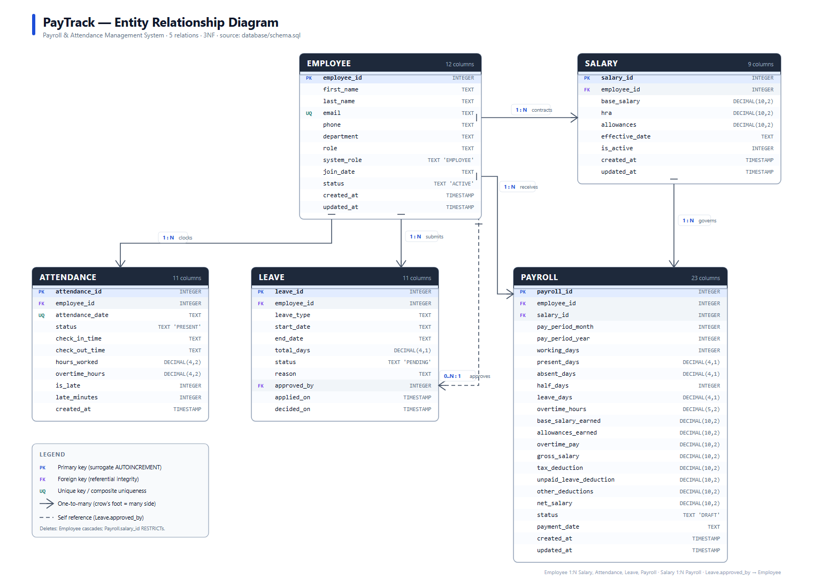
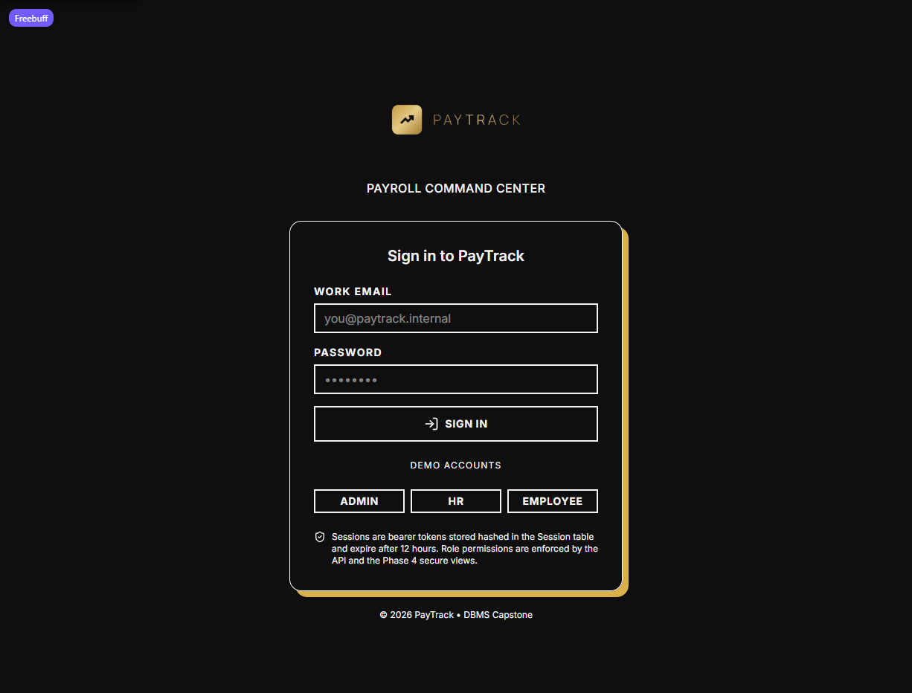
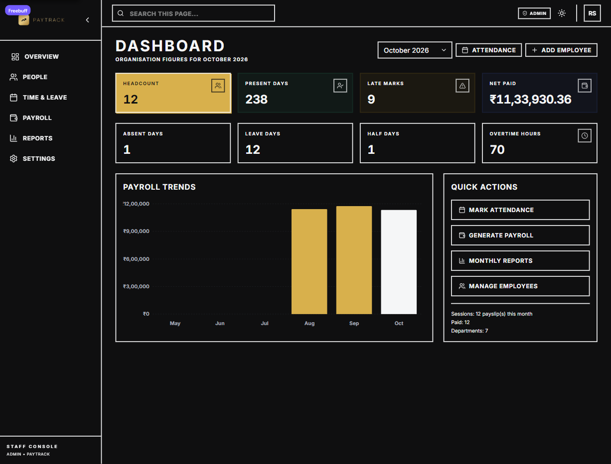
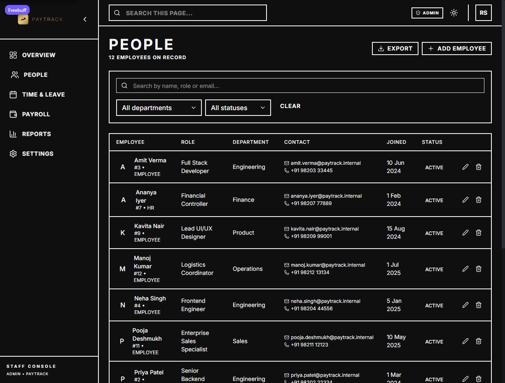
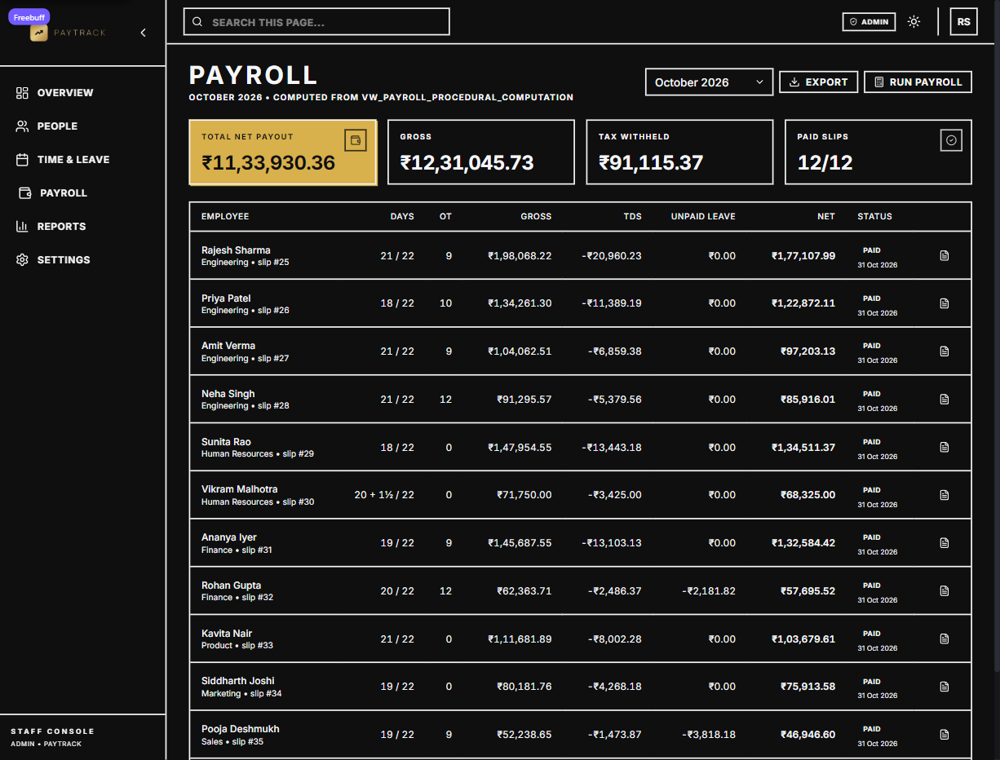
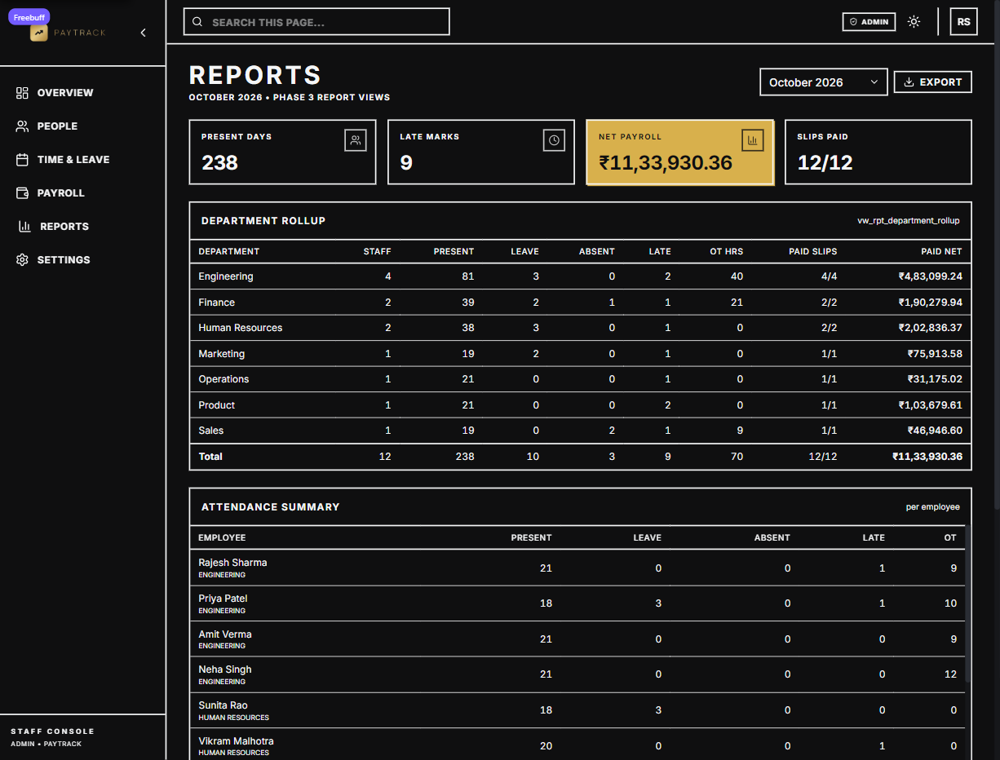
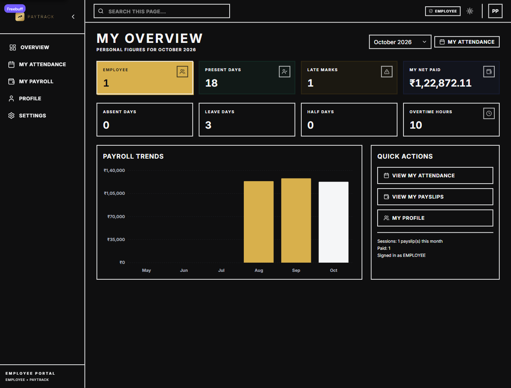

# PayTrack — Final Project Report

**Payroll & Attendance Management System**

| | |
|---|---|
| **Student Name** | Vinayak |
| **Roll Number** | 2501730150 |
| **Course** | Database Management Systems (Capstone Project) |
| **University** | K.R. Mangalam University |
| **Project** | PayTrack – Payroll & Attendance Management System |
| **Deliverable** | Complete Project Report (Phases 1–5 Integration, ER Model, Implementation & Outputs) |

---

## 1. Executive Summary & Proposed Solution

PayTrack is an end-to-end payroll and attendance management system designed for small to mid-sized organisations. It was engineered across five incremental phases: relational 3NF modelling, procedural SQL logic and triggers, indexed reporting views, database-level RBAC and row-level security, and a role-based React web client connected to a zero-framework Node.js REST API.

The core architectural decision is that **the database owns the business rules**. Salary proration, overtime calculation, progressive tax slabs, unpaid leave deductions, and late-mark detection are enforced directly by SQL views, `CHECK` constraints, and `BEFORE`/`AFTER` triggers. Access control is enforced through row-level secure views (`vw_secure_*`) backed by an RBAC model stored as relational data (`Role`, `Permission`, `RolePermission`, `UserRole`). The Node.js API validates inputs, manages hashed bearer sessions, and wraps multi-row mutations in explicit `BEGIN IMMEDIATE ... COMMIT` transactions, while the React client renders API responses without duplicating business logic.

The seeded dataset — **12 employees across 7 departments, 1,104 attendance records, and 36 payslips** spanning August–October 2026 — exercises every rule: paid vs. unpaid leave, overtime, half days, absences, late check-ins, and progressive tax slabs. All four automated test suites pass (**134** end-to-end DB tests, **46** reporting & query-plan tests, **51** security & RBAC tests, and **94** REST API tests — **325 assertions total**).

---

## 2. Problem Statement & Objectives

Manual payroll in small organisations typically relies on disconnected spreadsheets:
- Attendance is entered manually and prone to duplicate entries, future-dated logs, or invalid overtime claims.
- Unpaid leave and overtime rules are applied inconsistently across months.
- Tax is recalculated manually every cycle, and historical payslips become unreproducible once an employee receives a raise.
- Sensitive salary data lives in shared files with coarse file-level permissions rather than row-level access control.

**Proposed Solution Objectives:**
1. **Single Source of Truth** — One SQL computation (`vw_payroll_procedural_computation`) drives payslips, payroll runs, and department reports.
2. **Immutable Financial Snapshots** — `Payroll` stores gross, tax, deductions, and net pay as paid, keeping historical ledgers immune to future salary revisions.
3. **Database-Enforced Integrity** — Triggers and `CHECK` constraints reject invalid states regardless of whether writes come from the UI, API, or direct SQL.
4. **Row-Level Security & RBAC** — `ADMIN` and `HR` manage organisational data; `EMPLOYEE` users can read only their own attendance and payslips.
5. **Responsive Capstone UI** — A mobile-first React + TypeScript interface supporting daily attendance, payroll generation, and reporting.

---

## 3. Technologies Used

| Layer | Technology / Library | Version / Runtime | Purpose |
|---|---|---|---|
| **Database Engine** | SQLite 3 (`node:sqlite` `DatabaseSync`) | SQLite 3.51.3 | 3NF schema, triggers, views, indexes, RBAC tables |
| **Backend Runtime** | Node.js (`node:http`, `node:crypto`) | Node.js v24.15.0 | Zero-framework REST API, SHA-256 salted auth, transactions |
| **Frontend Framework** | React + TypeScript | React 19.2.0 / TS 5.9.3 | Role-based SPA with strict contract types |
| **Build & Styling** | Vite + Tailwind CSS | Vite 7.2.4 / Tailwind 4.1.18 | Production bundling, responsive utility styling, PWA |
| **Data Visualization** | Recharts | Recharts 3.7.0 | Six-month payroll trend bar chart |
| **Form & Validation** | React Hook Form + Zod | RHF 7.71.1 / Zod 4.3.6 | Client-side form state and schema validation |
| **Testing** | Custom Node.js Test Runners | 4 Suites (325 tests) | Ephemeral isolated DB testing, `EXPLAIN QUERY PLAN`, HTTP fetch |

---

## 4. Architecture

```
React 19 + TypeScript (Vite SPA)
   │  JSON · Authorization: Bearer <token>
Node.js REST API (node:http + node:sqlite, zero framework)
   │  Prepared SQL statements, BEGIN IMMEDIATE ... COMMIT
SQLite 3 Engine
   schema.sql → procedures.sql → triggers.sql → seed.sql → security.sql → reports.sql
```

| Layer | Responsibility | Key Artefacts |
|---|---|---|
| **Presentation** | Role-aware routes, month selector, forms, charts, CSV export | `src/pages/*`, `src/components/*`, `src/contexts/*`, `src/lib/api.ts` |
| **API** | Token auth, input validation, RBAC checks, transaction boundaries | `server/http.js`, `server/auth.js`, `server/routes/*` |
| **Data** | 3NF tables, triggers, procedural views, secure views, report indexes | `database/schema.sql`, `triggers.sql`, `procedures.sql`, `security.sql`, `reports.sql` |

---

## 5. Entity-Relationship (ER) Model & Data Design


*Figure 1: PayTrack 3NF Entity-Relationship Diagram showing the five core entities, keys, cardinalities, and self-referencing leave approval relationship.*

### Core Entities & Cardinalities
1. **`Employee` (1) → (1..N) `Salary`**: Maintains effective-dated compensation packages (`base_salary`, `hra`, `allowances`, `effective_date`, `is_active`). Raises insert a new `Salary` row rather than overwriting history.
2. **`Employee` (1) → (0..N) `Attendance`**: Daily shift logs with `UNIQUE (employee_id, attendance_date)`, check-in/out times, `hours_worked`, `overtime_hours`, `is_late`, and `late_minutes`.
3. **`Employee` (1) → (0..N) `Leave` (and `0..N : 1` `approved_by`)**: Tracks leave applications (`CASUAL`, `SICK`, `EARNED`, `UNPAID`) with a self-referencing foreign key `approved_by → Employee(employee_id)` and `CHECK (end_date >= start_date)`.
4. **`Employee` (1) → (0..N) `Payroll` & `Salary` (1) → (0..N) `Payroll`**: Stores finalized monthly payslip snapshots with `UNIQUE (employee_id, pay_period_year, pay_period_month)` and status lifecycle `DRAFT → APPROVED → PAID`.
5. **Security & RBAC Entities**: `AuthUser`, `Session`, `Role`, `Permission`, `RolePermission`, `UserRole`, and `SessionContext` enforce authentication and row-level scoping inside SQLite.

---

## 6. Implementation Details (Code Snippets)

Below are **9 core implementation snippets** extracted directly from the database, backend API, and frontend client.

### Implementation Snippet 1 — 3NF Relational Schema with Referential Integrity (`database/schema.sql`)
```sql
CREATE TABLE Employee (
    employee_id     INTEGER PRIMARY KEY AUTOINCREMENT,
    first_name      TEXT NOT NULL,
    last_name       TEXT NOT NULL,
    email           TEXT NOT NULL UNIQUE,
    phone           TEXT,
    department      TEXT NOT NULL,
    role            TEXT NOT NULL,
    system_role     TEXT NOT NULL DEFAULT 'EMPLOYEE' CHECK (system_role IN ('ADMIN', 'HR', 'EMPLOYEE')),
    join_date       TEXT NOT NULL,
    status          TEXT NOT NULL DEFAULT 'ACTIVE' CHECK (status IN ('ACTIVE', 'INACTIVE', 'TERMINATED')),
    created_at      TEXT DEFAULT CURRENT_TIMESTAMP,
    updated_at      TEXT DEFAULT CURRENT_TIMESTAMP
);

CREATE TABLE Attendance (
    attendance_id   INTEGER PRIMARY KEY AUTOINCREMENT,
    employee_id     INTEGER NOT NULL,
    attendance_date TEXT NOT NULL,
    status          TEXT NOT NULL DEFAULT 'PRESENT'
                    CHECK (status IN ('PRESENT', 'ABSENT', 'HALF_DAY', 'ON_LEAVE', 'HOLIDAY')),
    check_in_time   TEXT,
    check_out_time  TEXT,
    hours_worked    DECIMAL(4,2) NOT NULL DEFAULT 0.00 CHECK (hours_worked >= 0.00 AND hours_worked <= 24.00),
    overtime_hours  DECIMAL(4,2) NOT NULL DEFAULT 0.00 CHECK (overtime_hours >= 0.00 AND overtime_hours <= 16.00),
    is_late         INTEGER NOT NULL DEFAULT 0 CHECK (is_late IN (0, 1)),
    late_minutes    INTEGER NOT NULL DEFAULT 0 CHECK (late_minutes >= 0),
    created_at      TEXT DEFAULT CURRENT_TIMESTAMP,
    CONSTRAINT fk_attendance_employee
        FOREIGN KEY (employee_id) REFERENCES Employee(employee_id)
        ON DELETE CASCADE ON UPDATE CASCADE,
    CONSTRAINT uq_attendance_emp_date UNIQUE (employee_id, attendance_date)
);
```

### Implementation Snippet 2 — Attendance Validation & Auto-Late Triggers (`database/triggers.sql`)
```sql
CREATE TRIGGER trg_validate_attendance_bounds_insert
BEFORE INSERT ON Attendance
FOR EACH ROW
BEGIN
    SELECT RAISE(ABORT, 'Error: Attendance date cannot be in the future')
    WHERE NEW.attendance_date > CURRENT_DATE;

    SELECT RAISE(ABORT, 'Error: Overtime hours cannot be clocked for an ABSENT employee')
    WHERE NEW.status = 'ABSENT' AND NEW.overtime_hours > 0.00;

    SELECT RAISE(ABORT, 'Error: Overtime hours cannot exceed total hours worked')
    WHERE NEW.overtime_hours > NEW.hours_worked;
END;

CREATE TRIGGER trg_auto_late_mark_insert
AFTER INSERT ON Attendance
FOR EACH ROW
WHEN NEW.check_in_time IS NOT NULL
 AND NEW.check_in_time > '09:30:00'
 AND (NEW.is_late = 0 OR NEW.late_minutes = 0)
BEGIN
    UPDATE Attendance
    SET is_late = 1,
        late_minutes = CAST((strftime('%H', NEW.check_in_time) * 60 + strftime('%M', NEW.check_in_time) - 570) AS INTEGER)
    WHERE attendance_id = NEW.attendance_id;
END;
```

### Implementation Snippet 3 — Overlapping Approved Leave Prevention Trigger (`database/triggers.sql`)
```sql
CREATE TRIGGER trg_prevent_leave_overlap_insert
BEFORE INSERT ON Leave
FOR EACH ROW
WHEN NEW.status = 'APPROVED'
BEGIN
    SELECT RAISE(ABORT, 'Error: Overlapping approved leave exists for this employee')
    WHERE EXISTS (
        SELECT 1 FROM Leave
        WHERE employee_id = NEW.employee_id
          AND status = 'APPROVED'
          AND start_date <= NEW.end_date
          AND end_date >= NEW.start_date
    );
END;
```

### Implementation Snippet 4 — Procedural Payroll & Progressive Tax Computation (`database/procedures.sql`)
```sql
CREATE VIEW vw_payroll_procedural_computation AS
WITH BaseMetrics AS (
    SELECT
        e.employee_id, s.salary_id,
        CAST(att.attendance_year AS INTEGER) AS pay_period_year,
        CAST(att.attendance_month AS INTEGER) AS pay_period_month,
        s.base_salary, s.hra, s.allowances, 22 AS working_days,
        att.present_days, att.half_days, att.leave_days, att.absent_days, att.total_overtime_hours,
        (att.present_days + (att.half_days * 0.5) + att.leave_days) AS effective_work_days,
        ROUND(s.base_salary / 22.0, 2) AS daily_rate,
        ROUND(s.base_salary / (22.0 * 8.0), 2) AS hourly_rate
    FROM Employee e
    JOIN Salary s ON e.employee_id = s.employee_id AND s.is_active = 1
    JOIN vw_employee_attendance_monthly_summary att ON e.employee_id = att.employee_id
),
EarningsComputed AS (
    SELECT bm.*,
        ROUND(bm.effective_work_days * bm.daily_rate, 2) AS base_salary_earned,
        ROUND((bm.hra + bm.allowances) * (bm.effective_work_days / bm.working_days), 2) AS allowances_earned,
        ROUND(bm.total_overtime_hours * bm.hourly_rate * 1.0, 2) AS overtime_pay,
        ROUND(bm.absent_days * bm.daily_rate, 2) AS unpaid_leave_deduction,
        ROUND((bm.effective_work_days * bm.daily_rate) +
              ((bm.hra + bm.allowances) * (bm.effective_work_days / bm.working_days)) +
              (bm.total_overtime_hours * bm.hourly_rate * 1.0), 2) AS gross_salary
    FROM BaseMetrics bm
),
TaxAndNetComputed AS (
    SELECT ec.*,
        CASE
            WHEN ec.gross_salary <= 25000.00 THEN 0.00
            WHEN ec.gross_salary <= 50000.00 THEN ROUND((ec.gross_salary - 25000.00) * 0.05, 2)
            WHEN ec.gross_salary <= 100000.00 THEN ROUND(1250.00 + ((ec.gross_salary - 50000.00) * 0.10), 2)
            ELSE ROUND(6250.00 + ((ec.gross_salary - 100000.00) * 0.15), 2)
        END AS tax_deduction,
        0.00 AS other_deductions
    FROM EarningsComputed ec
)
SELECT *, ROUND(gross_salary - tax_deduction - unpaid_leave_deduction - other_deductions, 2) AS net_salary
FROM TaxAndNetComputed;
```

### Implementation Snippet 5 — Reporting Department Rollup View (`database/reports.sql`)
```sql
CREATE VIEW vw_rpt_department_rollup AS
WITH att AS (
    SELECT e.department, s.month_key,
        COUNT(*) AS employees_logged,
        SUM(s.present_days) AS present_days, SUM(s.half_days) AS half_days,
        SUM(s.leave_days) AS leave_days, SUM(s.absent_days) AS absent_days,
        ROUND(SUM(s.overtime_hours), 2) AS overtime_hours, SUM(s.late_marks) AS late_marks
    FROM vw_rpt_monthly_attendance_summary s
    JOIN Employee e ON e.employee_id = s.employee_id
    GROUP BY e.department, s.month_key
),
pay AS (
    SELECT sl.department, sl.month_key,
        COUNT(*) AS payroll_slips,
        SUM(CASE WHEN sl.status = 'PAID' THEN 1 ELSE 0 END) AS paid_slips,
        ROUND(SUM(CASE WHEN sl.status = 'PAID' THEN sl.gross_salary ELSE 0 END), 2) AS paid_gross_salary,
        ROUND(SUM(CASE WHEN sl.status = 'PAID' THEN sl.tax_deduction ELSE 0 END), 2) AS paid_tax_deduction,
        ROUND(SUM(CASE WHEN sl.status = 'PAID' THEN sl.net_salary ELSE 0 END), 2) AS paid_net_salary
    FROM vw_rpt_salary_slip sl
    GROUP BY sl.department, sl.month_key
)
SELECT COALESCE(att.department, pay.department) AS department,
       COALESCE(att.month_key, pay.month_key) AS month_key,
       COALESCE(att.employees_logged, 0) AS employees_logged,
       COALESCE(pay.paid_slips, 0) AS paid_slips,
       COALESCE(pay.paid_gross_salary, 0.0) AS paid_gross_salary,
       COALESCE(pay.paid_tax_deduction, 0.0) AS paid_tax_deduction,
       COALESCE(pay.paid_net_salary, 0.0) AS paid_net_salary
FROM att
FULL OUTER JOIN pay ON pay.department = att.department AND pay.month_key = att.month_key;
```

### Implementation Snippet 6 — Indexable Month Window & Report Indexes (`database/reports.sql`)
```sql
CREATE VIEW vw_rpt_attendance_month_scan AS
SELECT a.attendance_id, a.employee_id, a.attendance_date,
       substr(a.attendance_date, 1, 7) AS month_key,
       a.status, a.check_in_time, a.check_out_time,
       a.hours_worked, a.overtime_hours, a.is_late, a.late_minutes
FROM Attendance a
WHERE a.attendance_date >= current_month() || '-01'
  AND a.attendance_date <  COALESCE(strftime('%Y-%m', current_month() || '-01', '+1 month'), '9999-12-01');

CREATE INDEX IF NOT EXISTS idx_attendance_month_late
    ON Attendance(attendance_date, is_late, employee_id);

CREATE INDEX IF NOT EXISTS idx_payroll_period_status
    ON Payroll(pay_period_year, pay_period_month, status);
```

### Implementation Snippet 7 — Row-Level Security Views (`database/security.sql`)
```sql
CREATE VIEW IF NOT EXISTS vw_secure_payslips AS
SELECT
    p.payroll_id, p.employee_id,
    e.first_name || ' ' || e.last_name AS employee_name,
    e.department, p.salary_id, p.pay_period_month, p.pay_period_year,
    p.working_days, p.present_days, p.absent_days, p.half_days, p.leave_days,
    p.overtime_hours, p.base_salary_earned, p.allowances_earned, p.overtime_pay,
    p.gross_salary, p.tax_deduction, p.unpaid_leave_deduction, p.other_deductions,
    p.net_salary, p.status, p.payment_date
FROM Payroll p
JOIN Employee e ON e.employee_id = p.employee_id
CROSS JOIN vw_current_session cs
WHERE cs.session_employee_id IS NOT NULL
  AND EXISTS (SELECT 1 FROM vw_effective_permissions perm
              WHERE perm.perm_employee_id = cs.session_employee_id)
  AND (cs.system_role IN ('ADMIN', 'HR') OR p.employee_id = cs.session_employee_id);
```

### Implementation Snippet 8 — Transactional Payroll Generation Endpoint (`server/routes/payroll.js`)
```javascript
db.exec('BEGIN IMMEDIATE');
try {
  const locked = periodsWithSlips(db, month.year, month.month);
  if (locked.frozen > 0) throw conflict(`Payroll for ${month.key} is closed: slips are APPROVED or PAID.`);

  db.exec(COMPUTATION_STAGE);
  db.prepare(`DELETE FROM temp._paytrack_computed WHERE pay_period_year = ? AND pay_period_month = ?`)
    .run(month.year, month.month);
  db.prepare(`INSERT INTO temp._paytrack_computed SELECT * FROM vw_payroll_procedural_computation
              WHERE pay_period_year = ? AND pay_period_month = ?`)
    .run(month.year, month.month);
  db.prepare(COMPUTATION_INSERT).run(month.year, month.month);
  db.prepare(COMPUTATION_UPDATE).run(month.year, month.month);

  if (ctx.hooks?.payrollGenerate) ctx.hooks.payrollGenerate({ db, month, employeeId });
  const rows = db.prepare(`SELECT ${PAYROLL_SUMMARY_COLUMNS} FROM Payroll p
    JOIN Employee e ON e.employee_id = p.employee_id
    WHERE p.pay_period_year = ? AND p.pay_period_month = ? ORDER BY p.employee_id`)
    .all(month.year, month.month);
  db.exec('COMMIT');
  return { status: 200, data: { month: month.key, generated: rows.length, payroll: rows.map(toPayrollSummary) } };
} catch (err) {
  try { db.exec('ROLLBACK'); } catch { /* already rolled back */ }
  throw fromDatabaseError(err);
}
```

### Implementation Snippet 9 — Typed Frontend API Client (`src/lib/api.ts`)
```typescript
async function request<T>(path: string, options: RequestOptions = {}): Promise<T> {
    const headers: Record<string, string> = { Accept: 'application/json' };
    const token = getStoredToken();
    if (options.auth !== false && token) headers.Authorization = `Bearer ${token}`;

    let body: string | undefined;
    if (options.body !== undefined) {
        headers['Content-Type'] = 'application/json';
        body = JSON.stringify(options.body);
    }

    const response = await fetch(`${API_BASE_URL}${path}`, {
        method: options.method ?? 'GET',
        headers,
        body,
    });
    // Parses { data } envelope or throws typed ApiError(code, message, status)
}
```

---

## 7. Output Snippets & Query Verification

Below are **8 verified execution outputs** captured directly from the running PayTrack database, query planner, and test runners.

### Output Snippet 1 — End-to-End Database Test Suite (`node tests/run_e2e.js`)
```text
================================================================================
          PAYTRACK END-TO-END TEST SUITE (OPAQUE-BOX VERIFICATION)
================================================================================
Node Engine: v24.15.0 | SQLite: Built-in DatabaseSync | Mode: Ephemeral Isolated

[TIER 1] FEATURE COVERAGE (Core Functional Happy-Path)... DONE: 56 Passed, 0 Failed (578.67ms)
[TIER 2] BOUNDARY & CORNER CASES (Edge Conditions & Constraints)... DONE: 56 Passed, 0 Failed (2114.9ms)
[TIER 3] CROSS-FEATURE INTERACTIONS (Pairwise & State Transitions)... DONE: 16 Passed, 0 Failed (3931.52ms)
[TIER 4] REAL-WORLD SCENARIOS (End-to-End Enterprise Workloads)... DONE: 6 Passed, 0 Failed (65.78ms)

================================================================================
                               EXECUTION SUMMARY
================================================================================
  Total Tests Run: 134 | Passed: 134 | Failed: 0 | Skipped: 0
  Total Duration:  6692.47ms | Final Status: ALL TESTS PASSED (Exit Code: 0)
================================================================================
```

### Output Snippet 2 — `EXPLAIN QUERY PLAN` Before/After Indexing (`node tests/run_reports.js`)
```text
  [RPT-070] Month window over Attendance (monthly summary / late-marks report)
    SQL: SELECT * FROM vw_rpt_attendance_month_scan
    BEFORE (no report indexes):
      SEARCH a USING INDEX idx_attendance_date_late (attendance_date>? AND attendance_date<?)
    AFTER  (with idx_attendance_month_late):
      SEARCH a USING INDEX idx_attendance_month_late (attendance_date>? AND attendance_date<?)

  [RPT-071] Period payroll listing, then status inside the period
    Baseline SQL: SELECT * FROM Payroll WHERE pay_period_year = ? AND pay_period_month = ?
    SQL: SELECT * FROM Payroll WHERE pay_period_year = ? AND pay_period_month = ? AND status = ?
    Params: [2026,10,"PAID"]
    BEFORE (no report indexes), baseline query:
      SCAN Payroll
    AFTER  (with idx_payroll_period_status):
      SEARCH Payroll USING INDEX idx_payroll_period_status (pay_period_year=? AND pay_period_month=? AND status=?)

  [RPT-072] Month-key equality on substr() (measured, scan by construction)
    SQL: SELECT * FROM Attendance WHERE substr(attendance_date, 1, 7) = ?
    WITH / WITHOUT report indexes: SCAN Attendance
```

### Output Snippet 3 — Reporting Test Suite Summary (`node tests/run_reports.js`)
```text
================================================================================
        PAYTRACK PHASE 3 REPORT DEVELOPMENT TEST SUITE
================================================================================
Node Engine: v24.15.0 | SQLite: node:sqlite DatabaseSync | DB: os.tmpdir()
  Total Tests Run: 46 | Passed: 46 | Failed: 0 | Total Duration: 1169.09ms
  Final Status:    ALL TESTS PASSED (Exit Code: 0)
================================================================================
```

### Output Snippet 4 — Security & RBAC Test Suite (`node tests/phase4_security.test.js`)
```text
================================================================================
        PAYTRACK PHASE 4 SECURITY & ACCESS CONTROL TEST SUITE
================================================================================
Node Engine: v24.15.0 | SQLite: 3.51.3
Database   : template built in 459ms, copied fresh per case
Load order : schema.sql -> procedures.sql -> triggers.sql -> seed.sql -> security.sql

  Total Tests Run: 51  (VALID 19, INVALID 25, BOUND 7)
  Passed: 51 | Failed: 0 | Total Duration: 1777.1ms
  Final Status:    ALL TESTS PASSED (Exit Code: 0)
================================================================================
```

### Output Snippet 5 — REST API Contract Suite (`node tests/run_api.js`)
```text
================================================================================
          PAYTRACK PHASE 5 REST API TEST SUITE
================================================================================
Node Engine: v24.15.0 | SQLite: node:sqlite | Transport: HTTP + fetch

[T5] API CONTRACT (every endpoint x every role)... DONE: 94 Passed, 0 Failed (1178.33ms)

  Total Tests Run: 94 | Passed: 94 | Failed: 0 | Skipped: 0
  Final Status:    ALL TESTS PASSED (Exit Code: 0)
================================================================================
```

### Output Snippet 6 — Department Rollup Report Output (`vw_rpt_department_rollup`, October 2026)
```text
┌─────────┬───────────────────┬──────────────────┬────────────┬───────────────────┬────────────────────┬─────────────────┐
│ (index) │ department        │ employees_logged │ paid_slips │ paid_gross_salary │ paid_tax_deduction │ paid_net_salary │
├─────────┼───────────────────┼──────────────────┼────────────┼───────────────────┼────────────────────┼─────────────────┤
│ 0       │ 'Engineering'     │ 4                │ 4          │ 527687.6          │ 44588.36           │ 483099.24       │
│ 1       │ 'Finance'         │ 2                │ 2          │ 208051.26         │ 15589.5            │ 190279.94       │
│ 2       │ 'Human Resources' │ 2                │ 2          │ 219704.55         │ 16868.18           │ 202836.37       │
│ 3       │ 'Marketing'       │ 1                │ 1          │ 80181.76          │ 4268.18            │ 75913.58        │
│ 4       │ 'Operations'      │ 1                │ 1          │ 31500.02          │ 325                │ 31175.02        │
│ 5       │ 'Product'         │ 1                │ 1          │ 111681.89         │ 8002.28            │ 103679.61       │
│ 6       │ 'Sales'           │ 1                │ 1          │ 52238.65          │ 1473.87            │ 46946.6         │
└─────────┴───────────────────┴──────────────────┴────────────┴───────────────────┴────────────────────┴─────────────────┘
```

### Output Snippet 7 — Late Marks & Attendance Summary Output (`2026-10`)
```text
=== LATE MARKS (vw_rpt_late_marks, TOP 5) ===
┌─────────┬───────────────────┬───────────────────┬─────────────────┬───────────────┬──────────────┐
│ (index) │ employee_name     │ department        │ attendance_date │ check_in_time │ late_minutes │
├─────────┼───────────────────┼───────────────────┼─────────────────┼───────────────┼──────────────┤
│ 0       │ 'Rajesh Sharma'   │ 'Engineering'     │ '2026-10-16'    │ '09:52:00'    │ 22           │
│ 1       │ 'Priya Patel'     │ 'Engineering'     │ '2026-10-09'    │ '09:46:00'    │ 16           │
│ 2       │ 'Vikram Malhotra' │ 'Human Resources' │ '2026-10-27'    │ '10:08:00'    │ 38           │
│ 3       │ 'Rohan Gupta'     │ 'Finance'         │ '2026-10-13'    │ '09:56:00'    │ 26           │
│ 4       │ 'Kavita Nair'     │ 'Product'         │ '2026-10-06'    │ '09:50:00'    │ 20           │
└─────────┴───────────────────┴───────────────────┴─────────────────┴───────────────┴──────────────┘

=== ATTENDANCE SUMMARY (vw_rpt_monthly_attendance_summary, TOP 5) ===
┌─────────┬─────────────────┬──────────────┬───────────┬────────────┬─────────────┬────────────────┬────────────┬─────────────────────┬───────────────────────┐
│ (index) │ employee_name   │ present_days │ half_days │ leave_days │ absent_days │ overtime_hours │ late_marks │ effective_paid_days │ attendance_percentage │
├─────────┼─────────────────┼──────────────┼───────────┼────────────┼─────────────┼────────────────┼────────────┼─────────────────────┼───────────────────────┤
│ 0       │ 'Rajesh Sharma' │ 21           │ 0         │ 0          │ 0           │ 9              │ 1          │ 21                  │ 100                   │
│ 1       │ 'Priya Patel'   │ 18           │ 0         │ 3          │ 0           │ 10             │ 1          │ 21                  │ 100                   │
│ 2       │ 'Amit Verma'    │ 21           │ 0         │ 0          │ 0           │ 9              │ 0          │ 21                  │ 100                   │
│ 3       │ 'Neha Singh'    │ 21           │ 0         │ 0          │ 0           │ 12             │ 0          │ 21                  │ 100                   │
│ 4       │ 'Sunita Rao'    │ 18           │ 0         │ 3          │ 0           │ 0              │ 0          │ 21                  │ 100                   │
└─────────┴─────────────────┴──────────────┼───────────┼────────────┼─────────────┼────────────────┼────────────┼─────────────────────┼───────────────────────┘
```

### Output Snippet 8 — Finalized Payslip JSON Output (`vw_rpt_salary_slip`, `payroll_id = 25`)
```json
{
  "payroll_id": 25,
  "employee_name": "Rajesh Sharma",
  "department": "Engineering",
  "role": "Lead Systems Architect",
  "month_key": "2026-10",
  "working_days": 22,
  "present_days": 21,
  "overtime_hours": 9,
  "gross_salary": 198068.22,
  "tax_deduction": 20960.23,
  "net_salary": 177107.99,
  "status": "PAID"
}
```

---

## 8. Capstone Application Snapshots (Screenshots)

The following six snapshots capture the live PayTrack application connected to the Node.js API and SQLite database across Admin and Employee roles.


*Figure 2: PayTrack Sign-In Screen with role-based demo accounts (`ADMIN`, `HR`, `EMPLOYEE`) and hashed 12-hour bearer session authentication.*


*Figure 3: Admin Overview Dashboard displaying October 2026 organisational KPIs (12 headcount, 238 present days, 9 late marks, ₹11,33,930.36 net paid) and six-month payroll trends.*


*Figure 4: Workforce Directory (`/people`) showing 12 active employees, search/department/status filters, and staff-only edit/delete controls.*


*Figure 5: Payroll Ledger (`/payroll`) computed from `vw_payroll_procedural_computation`, displaying ₹12,31,045.73 gross, ₹91,115.37 tax withheld, and 12/12 paid slips.*


*Figure 6: Reports Console (`/reports`) powered by Phase 3 SQL views (`vw_rpt_department_rollup` and `vw_rpt_monthly_attendance_summary`).*


*Figure 7: Employee Self-Service Portal (`Priya Patel`, `EMPLOYEE` role) scoped by `vw_secure_*` views to display only her own attendance (18 present, 3 leave, 10 OT hrs) and net pay (₹1,22,872.11).*

---

## 9. Project Outcomes & Verified Metrics

### 9.1 Test & Build Verification
| Suite | Command | Result |
|---|---|---|
| Schema, procedures, triggers, end-to-end | `node tests/run_e2e.js` | **134 / 134 Passed** |
| Reporting and `EXPLAIN QUERY PLAN` | `node tests/run_reports.js` | **46 / 46 Passed** |
| Security, RBAC & rollback atomicity | `node tests/phase4_security.test.js` | **51 / 51 Passed** |
| REST API contract (all endpoints × roles) | `node tests/run_api.js` | **94 / 94 Passed** |
| Client TypeScript check & production build | `npm run build` (`tsc -b && vite build`) | **Passes** |

### 9.2 Verified October 2026 Operational Outcomes
- **Employees & Departments**: 12 active employees across 7 departments (Engineering, Finance, Human Resources, Marketing, Operations, Product, Sales).
- **Attendance Totals**: 238 present days, 9 late marks, 1 absent day, 12 paid leave days, 1 half day, and 70 overtime hours.
- **Payroll Totals**: 12 / 12 slips `PAID` — Gross **₹12,31,045.73**, Tax Withheld **₹91,115.37**, Net Paid **₹11,33,930.36**.
- **Spot-Check Accuracy**: Rajesh Sharma (21/22 days, 9 OT hrs) → Gross ₹1,98,068.22, TDS ₹20,960.23, Net ₹1,77,107.99; Priya Patel (18 present + 3 paid leave, 10 OT hrs) → Net ₹1,22,872.11.

### 9.3 Real-World Applicability & Scaling Roadmap
- **Applicable Domains**: Professional services firms, multi-outlet retail/hospitality, staffing agencies, university adjunct faculty payroll, and startup internal HR tooling.
- **Scaling Path**: Single-node SQLite → PostgreSQL with connection pooling and native Row-Level Security (RLS) → monthly attendance partitioning → materialised report aggregates → stateless API replicas behind a load balancer.
- **Current Limitations**: SQLite serialises concurrent writes to a single API process; statutory deductions (PF/ESI) and email/MFA password reset are out of scope for this capstone build.

---

## 10. Conclusion

PayTrack successfully replaces error-prone spreadsheet payroll with a normalised, auditable, and access-controlled database application. By placing proration, tax slabs, late-mark rules, and row-level security inside SQLite views and triggers — and verifying every layer with 325 automated tests and live UI snapshots — the system guarantees that payslips, reports, and role boundaries remain consistent end to end.

---

## Appendix — Demo Credentials

| Role | Email | Password |
|---|---|---|
| `ADMIN` | `rajesh.sharma@paytrack.internal` | `Admin@123` |
| `HR` | `sunita.rao@paytrack.internal` | `Hr@12345` |
| `EMPLOYEE` | `priya.patel@paytrack.internal` | `Employee@123` |
